<div align="center">
  <h1> GEMM CUDA 优化教学</h1>

  
  
  
  
  
  
</div>

<br>

从朴素 Kernel 到跑赢 cuBLAS，经过 12 个优化版本（共 17 个手写 kernel）。

内容包含共享内存分块、线程粗化、寄存器缓存、float4 向量化、XOR Swizzle、双缓冲、cp.async、寄存器软件流水、两级流水线、自定义分块形状等。

<br>

## 测试环境

RTX 5060 Laptop GPU（Blackwell，sm_120）。

CUDA Event 计时，预热、重复 100 次取平均值与中位数、交替采样、奇偶轮反转执行顺序，保护对比公平性。

支持热缓存（不冲刷 L2）、冷缓存（冲刷 L2）两种模式（本仓库所有性能数据均在冷缓存下测得）。

同一台机器上分别用 `-arch=native` 和 `-arch=sm_80` 编译各实测一次，不同编译器调度的测试结果虽有不同，但总体趋势一致。

**最终版效果**：以 `-arch=native` 编译数据来看，在 2048、3072、4096、5120、6144 五个尺寸上，版本 GEMM12 分别达到 cuBLAS（FP32）性能的 115%、119%、110%、116%、115%。

**性能总览（`-arch=native` 编译）：**


**性能总览（`-arch=sm_80` 编译）：**

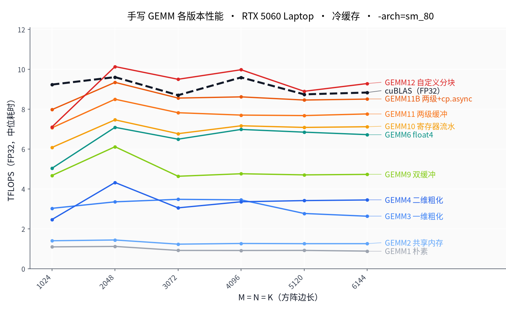

> 以上性能图只收录 11 个代表性版本

### 4096 尺寸性能表（-arch=native）

> 更多关于 全尺寸、全版本 的数据见文件 [test/benchmark_native.txt](test/benchmark_native.txt)（`-arch=native` 编译结果） 与 [test/benchmark_sm80.txt](test/benchmark_sm80.txt)（`-arch=sm_80` 编译结果）

| 阶段 | 版本 | 名称 | 内容概述 | 耗时 (ms) | TFLOPS | 占 cuBLAS % |
| --- | --- | --- | --- | ---: | ---: | ---: |
| 基线 | GEMM1 | 朴素移植 | block 32×32、一线程一元素 | 188.49 | 0.73 | 7.4% |
| 数据复用 | GEMM2 | 共享内存分块 | BM=BN=BK=32，把全局访存量从 O(MNK) 降下来 | 110.52 | 1.24 | 12.6% |
| 线程粗化 | GEMM3 | 一维线程粗化 | TM=8，单线程多元素，改善计算访存比 | 36.54 | 3.76 | 38.2% |
| 线程粗化 | GEMM4 | 二维线程粗化 | TM=TN=8，N 方向同样粗化 | 21.25 | 6.47 | 65.7% |
| 寄存器 | GEMM5 | 寄存器复用 | TM=TN=8，B 值先进寄存器、避免共享内存重复读 | 21.00 | 6.55 | 66.5% |
| 向量化 | GEMM6 | float4 访存向量化 | 128-bit LDG/STG，削减访存指令数 | 20.88 | 6.58 | 66.8% |
| 向量化 | GEMM6B | float4 计算向量化 | 128-bit LDS，削减计算阶段 LDS 指令数 | 18.58 | 7.40 | 75.1% |
| Bank 冲突 | GEMM7 | bank 冲突反例 | Bds[BN][BK] 转置布局，刻意展示的 bank 冲突的反面教材 | 42.32 | 3.25 | 33.0% |
| Bank 冲突 | GEMM7B | k_offset 旋转 | 加 k_offset 旋转，缓解计算阶段冲突 | 21.29 | 6.46 | 65.6% |
| Bank 冲突 | GEMM8 | XOR Swizzle | 用 Swizzle 映射，同时化解加载与计算两处冲突 | 16.27 | 8.45 | 85.8% |
| 流水线 | GEMM9 | 朴素双缓冲 | 动态 SMEM 64 KB 双缓冲，但加载与计算仍串行 | 20.59 | 6.68 | 67.8% |
| 流水线 | GEMM9B | cp.async 双缓冲 | A 侧用 DMA，省发射槽 | 20.46 | 6.72 | 68.2% |
| 流水线 | GEMM10 | 寄存器流水 | issue/commit 拆分，让双缓冲真正形成流水 | 17.79 | 7.73 | 78.5% |
| 流水线 | GEMM10B | 混合流水 | A 侧 cp.async，省掉预取寄存器 | 16.82 | 8.17 | 83.0% |
| 两级流水 | GEMM11 | 两级双缓冲 | 转置布局 [BK][BM] + fragment 双缓冲，掩盖 SMEM→寄存器读延迟 | 17.80 | 7.72 | 78.4% |
| 两级流水 | GEMM11B | 两级 + cp.async | B 侧走 DMA，省加载指令 | 16.39 | 8.39 | 85.2% |
| 结构调优 | GEMM12 | 自定义分块 | BK=16、TM=16、TN=8、128 线程，平衡分块/寄存器/占用率 | 12.67 | 10.85 | 110.2% |
| 基准 | GEMM13 | cuBLAS (FP32) | 官方库对照 | 13.96 | 9.85 | 100.0% |
| 基准 | GEMM14 | cuBLASLt (FP32) | 官方库对照 | 14.46 | 9.50 | 96.5% |

### NCU Summary（4096 尺寸，-arch=native）


<br>

---

## 前置知识

### GPU 的存储层级

CUDA kernel 能用的存储分四层，越往上越快、越小、越私有。

所有 GEMM 优化做的事，概括起来就是把数据从下层搬到上层，并在上层反复使用。

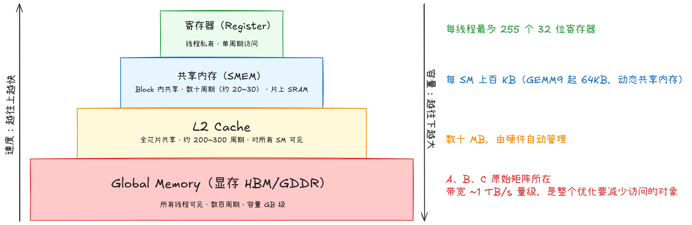

### 线程层级：Grid、Block、Thread

一个 kernel 启动后，GPU 上的线程组织成三级结构。

计算 C 矩阵时，Grid 内所有 block 铺满整个 C，每个 block 负责一个 tile，block 内每个线程再负责 tile 中的一个元素或一小块。


<br>

---

## 优化路线逐版本讲解

计算 `C = A @ B`，`A (M,K)`、`B (K,N)`、`C (M,N)` ，均为行主序。

> 完整代码见 [GEMM.cu](GEMM.cu) 文件。

---

## GEMM1：朴素版

一个线程负责一个输出元素 `C[row][col]`，沿 K 串行读取 A 的一行和 B 的一列做点积。

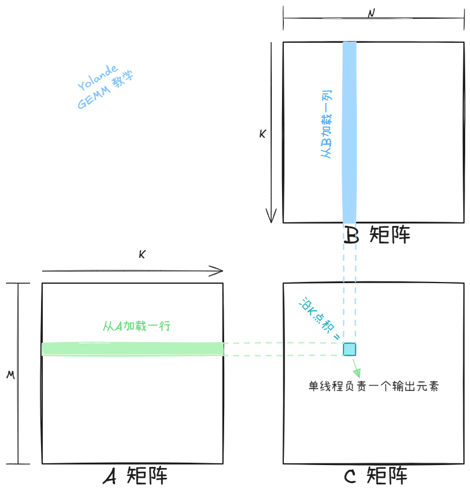

```cpp
__global__ void GEMM1(float* C, const float* A, const float* B, int M, int N, int K) {
    // 每个线程计算一个输出元素 C[row, col]
    int row = blockIdx.y * blockDim.y + threadIdx.y;  // 全局行号
    int col = blockIdx.x * blockDim.x + threadIdx.x;  // 全局列号
    if (row < M && col < N) {  // 避免越界
        float sum = 0.0f;
        // 串行遍历 K 维度，完成点积
        for (int k = 0; k < K; k++)
            sum += A[row * K + k] * B[k * N + col];
        C[row * N + col] = sum;  // 每个线程写入自己负责的输出位
    }
}
```

| 版本 | 耗时(ms) | TFLOPS | 占cuBLAS % |
| --- | ---: | ---: | ---: |
| GEMM1 | 188.49 | 0.73 | 7.4% |

**一些问题：**
- 每个线程只算一个输出。每做一次 FMA，就要读两次全局内存，计算和访存的比例是 1:2，极低，SM 浮点运算单元跑不满，无法隐藏访存延迟。
- 每个 C 元素都要读一整行 A 和一整列 B，相同位置元素被重复读取，完成全部计算需要 2 * K * M * N。要知道全局内存访问延迟最高，频繁重复的访问浪费大量时间。

<br>

## GEMM2：共享内存分块

**GEMM1** 的问题在于"同一个数据被不同线程反复从全局内存读取"。

一个 32×32 的输出 tile 里，所有线程合起来只用到 32 行 A 和 32 列 B。

可以先把这两块数据搬到共享内存，块内线程再从共享内存读。这样一来，数据的反复读取发生在共享内存里而不是全局内存里。

**实现：**

把 A、B 各切分成 32x32 的小块（tile）。

每次循环加载一个 tile 到 shared memory，然后块内所有线程从 shared memory 里读取，共同计算对应的 32x32 输出。

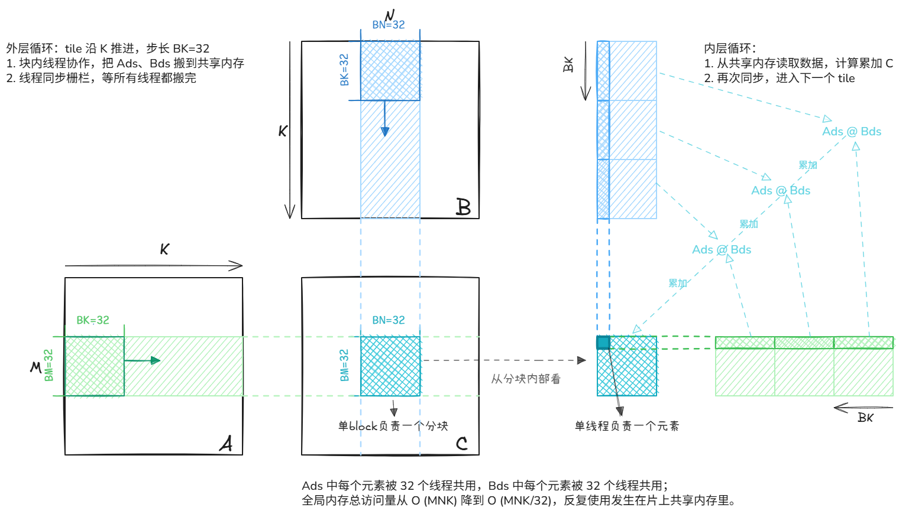

```cpp
__global__ void GEMM2(float* C, const float* A, const float* B, int M, int N, int K) {
    constexpr int BK = 32, BM = 32, BN = 32;  // 共享内存边长大小
    // 把 A、B 的 32x32 tile 搬到 shared memory 让块内线程共享（本版核心优化）
    __shared__ float Ads[BM][BK];  // A 的 32x32 子块缓存
    __shared__ float Bds[BK][BN];  // B 的 32x32 子块缓存
    int ty = threadIdx.y, tx = threadIdx.x;
    int row = blockIdx.y * BM + ty;
    int col = blockIdx.x * BN + tx;
    // 每线程 1 个输出的累加器
    float sum = 0.0f;
    // 还是沿公共维度，但每次跨步 BK=32
    for (int tile = 0; tile < K; tile += BK) {
        // 协作加载 A 子块到共享内存
        Ads[ty][tx] = (row < M && tile + tx < K) ? A[row * K + tile + tx] : 0.0f;
        // 协作加载 B 子块到共享内存
        Bds[ty][tx] = (tile + ty < K && col < N) ? B[(tile + ty) * N + col] : 0.0f;
        // 等待所有线程完成加载
        __syncthreads();
        // 从共享内存中读取数据进行乘加
        for (int k = 0; k < BK; k++)
            sum += Ads[ty][k] * Bds[k][tx];
        // 同步，确保计算完成后再覆盖共享内存
        __syncthreads();
    }
    if (row < M && col < N) C[row * N + col] = sum;
}
```

| 版本 | 耗时(ms) | TFLOPS | 占cuBLAS % |
| --- | ---: | ---: | ---: |
| GEMM1 | 188.49 | 0.73 | 7.4% |
| GEMM2 | 110.52 | 1.24 | 12.6% |

**收益：**

A tile 的每个元素被 ty 方向的 32 个线程共用，B tile 的每个元素被 tx 方向的 32 个线程共用。

不用频繁访问全局内存，全局访存量从 O(M*N*K) 降到 O(M*N*K/32)，减少 32 倍。

另外因访问地址转移到延迟低得多的 shared memory，计算效率也得到一些提升。

<br>

---

## 关于线程粗化（GEMM3、GEMM4）

**GEMM2** 虽然优化了全局访存量，但每线程只算 1 个输出元素。内层 k 循环里每做 1 次 FMA 要读 2 次共享内存（Ads、Bds 各 1 次），计算访存比是 1:2，SM 的浮点运算单元每工作 1 拍就要等 2 次访存，大量空闲。

如果让一个线程同时算多个输出，读进寄存器的数据可以被多个累加器反复使用，这样每次访存能换来多次 FMA，这就是线程粗化（thread tiling）。

>寄存器是比共享内存更快的一级存储，把数据放到寄存器里复用，是后续优化的地基。

---

## GEMM3：一维线程粗化（TM=8）

**说明**：
- 每线程沿 M 方向负责 TM=8 个输出元素；B 值读 1 次、被 8 个累加器共享（参与 8 次 FMA）
- 每个内层 k 迭代：读 Ads 的 8 个值 + Bds 的 1 个值到寄存器，寄存器内做 8 次 FMA，计算访存比从 1:2 升到 8:9；
- block 改为 32×16=512 线程，覆盖 128×32 的输出 tile。

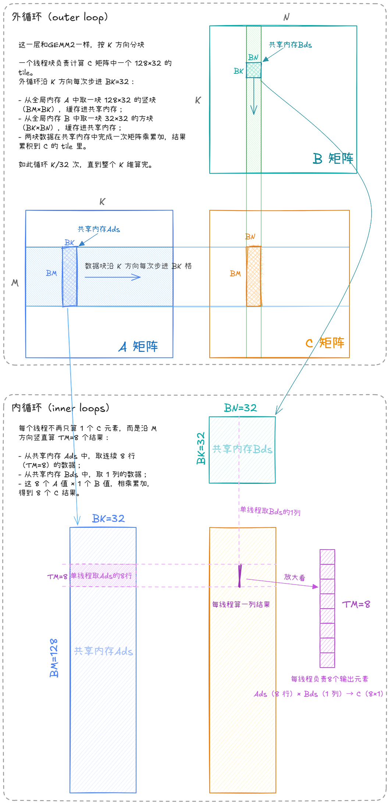

```cpp
__global__ void GEMM3(float* C, const float* A, const float* B, int M, int N, int K) {
    // TM=8 是本版的核心配置：每线程负责 8 行输出（一维粗化）
    constexpr int BK = 32, BM = 128, BN = 32, TM = 8;
    __shared__ float Ads[BM][BK];
    __shared__ float Bds[BK][BN];
    int ty = threadIdx.y, tx = threadIdx.x;
    int tid = ty * blockDim.x + tx;

    // 每线程的 TM=8 个寄存器累加器
    float val[TM] = {0.0f};

    for (int tile = 0; tile < K; tile += BK) {
        // 步长循环加载 A tile：每个线程加载多个元素
        for (int i = tid; i < BM * BK; i += blockDim.x * blockDim.y) {
            int m = i / BK, k = i % BK;
            Ads[m][k] = A[(blockIdx.y * BM + m) * K + tile + k];
        }
        // 步长循环加载 B tile
        for (int i = tid; i < BK * BN; i += blockDim.x * blockDim.y) {
            int k = i / BN, n = i % BN;
            Bds[k][n] = B[(tile + k) * N + blockIdx.x * BN + n];
        }
        __syncthreads();

        // 一维粗化：每线程沿 M 方向累加 TM 个输出，Bds 只读一次，复用 TM 次
        for (int k = 0; k < BK; k++) {
            float b_val = Bds[k][tx];
            for (int i = 0; i < TM; i++)
                val[i] += Ads[ty * TM + i][k] * b_val;
        }
        __syncthreads();
    }

    // 每线程沿 M 方向写入 TM 个输出
    for (int i = 0; i < TM; i++)
        C[(blockIdx.y * BM + ty * TM + i) * N + blockIdx.x * BN + tx] = val[i];
}
```

| 版本 | 耗时(ms) | TFLOPS | 占cuBLAS % |
| --- | ---: | ---: | ---: |
| GEMM2 | 110.52 | 1.24 | 12.6% |
| GEMM3 | 36.54 | 3.76 | 38.2% |

<br>

## GEMM4：二维线程粗化（TM=TN=8）

**GEMM3** 只粗化了 M 方向：B 值读 1 次、被 TM 个累加器共享；但 A 值每个仍只参与 1 次 FMA，N 方向没有任何复用，共享内存访问量仍然偏高。所以这版对 N 方向也进行粗化。

**说明**：
- 两方向同时粗化：每线程负责 TM×TN=64 个输出，设置一个二维形状的累加器；
- 每个内层 k 迭代：读 Ads 的 8 个值 + Bds 的 8 个值，做 64 次 FMA，计算访存比变成 64:16（4:1），比 GEMM3 的 8:9 进一步提升，计算单元喂得更饱；
- block 改为 16×16=256 线程，覆盖 128×128 的输出 tile，全局内存访存量减少至 1/128，进一步降低。

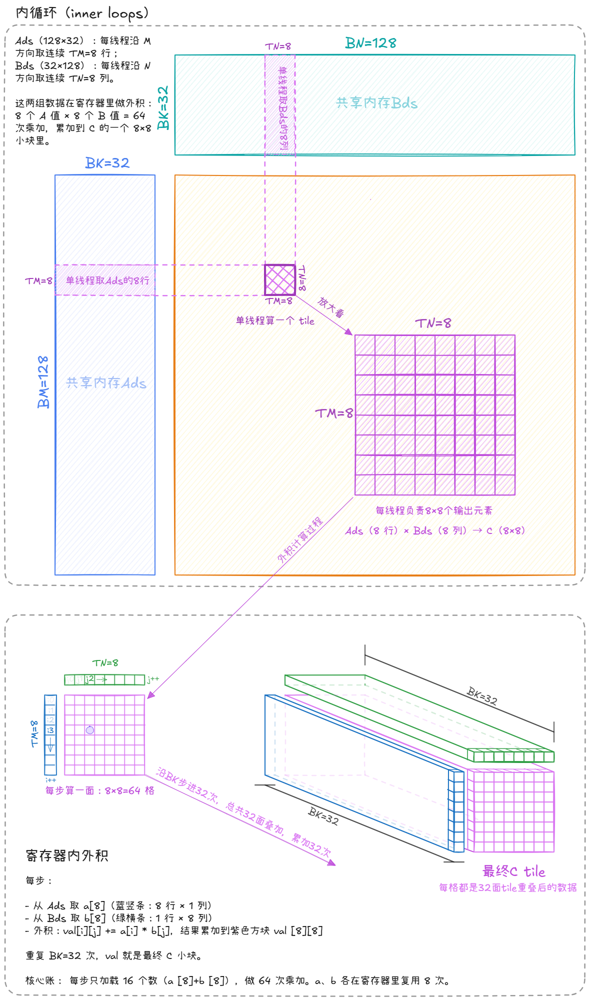

```cpp
__global__ void GEMM4(float* C, const float* A, const float* B, int M, int N, int K) {
    // 从一维粗化扩展到二维：TM=TN=8，每线程负责 64 个输出
    constexpr int BK = 32, BM = 128, BN = 128, TM = 8, TN = 8;
    __shared__ float Ads[BM][BK];
    __shared__ float Bds[BK][BN];
    int ty = threadIdx.y, tx = threadIdx.x;
    int tid = ty * blockDim.x + tx;

    // 每线程的 TM×TN=64 个寄存器累加器
    float val[TM][TN] = {0.0f};

    for (int tile = 0; tile < K; tile += BK) {
        for (int i = tid; i < BM * BK; i += blockDim.x * blockDim.y) {
            int m = i / BK, k = i % BK;
            Ads[m][k] = A[(blockIdx.y * BM + m) * K + tile + k];
        }
        for (int i = tid; i < BK * BN; i += blockDim.x * blockDim.y) {
            int k = i / BN, n = i % BN;
            Bds[k][n] = B[(tile + k) * N + blockIdx.x * BN + n];
        }
        __syncthreads();

        // 二维粗化计算：充分利用 64 个寄存器累加器
        for (int k = 0; k < BK; k++)
            for (int i = 0; i < TM; i++)
                for (int j = 0; j < TN; j++)
                    val[i][j] += Ads[ty * TM + i][k] * Bds[k][tx * TN + j];
        __syncthreads();
    }

    // 每线程沿 M、N 两个方向写回 TM×TN 个输出
    for (int i = 0; i < TM; i++)
        for (int j = 0; j < TN; j++)
            C[(blockIdx.y * BM + ty * TM + i) * N + blockIdx.x * BN + tx * TN + j] = val[i][j];
}
```

| 版本 | 耗时(ms) | TFLOPS | 占cuBLAS % |
| --- | ---: | ---: | ---: |
| GEMM3 | 36.54 | 3.76 | 38.2% |
| GEMM4 | 21.25 | 6.47 | 65.7% |

**注意**：线程粗化因子也不是越大越好，因子越大，累加器占用的寄存器数量越多，occupancy 开始下降，这会降低 SM 中可供切换的 warp 数量，使延迟隐藏能力降低。

<br>

## GEMM5：寄存器复用

看 **GEMM4** 内层三重循环：

```cpp
for k in BK:
  for i in TM:
    for j in TN:
      val[i][j] += Ads[ty*TM+i][k] * Bds[k][tx*TN+j]
```

Bds 的同一个值在 i 循环里被重复读了 TM 次。如果把 Bds 的这一行先读到寄存器（B 列预加载），就不用反复访问 shared。

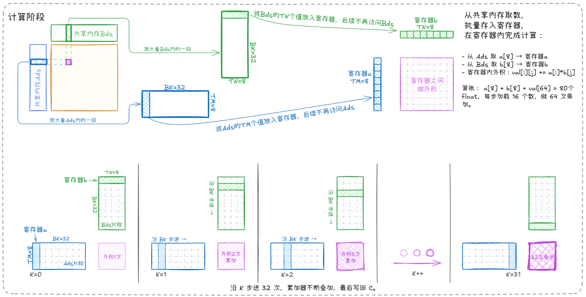

> 这个方法在 SMEM 带宽成为瓶颈时收益明显

**实现**：
- 先读 B 的 TN 个值到寄存器数组 b_val[TN]。
- 再对每个 i，读一次 Ads 到寄存器，用 b_val 做 TN 次 FMA。（a不用显式定义数组，用标量效果一样）

```cpp
// 除计算阶段以外，所有代码与上版本完全相同，不再赘述
// 计算阶段
for (int k = 0; k < BK; k++) {
    // 本版核心：先把 B 的 TN 个值读到寄存器，之后 TM×TN 次 FMA 都不再访问 Bds
    float b_val[TN];
    for (int j = 0; j < TN; j++)
        b_val[j] = Bds[k][tx * TN + j];
    // 再读 A 的 TM 个值，做 TM*TN 次 FMA
    for (int i = 0; i < TM; i++) {
        float a_val = Ads[ty * TM + i][k];
        for (int j = 0; j < TN; j++)
            val[i][j] += a_val * b_val[j];
    }
}
__syncthreads();
```

**收益**：
- Bds 访问次数：TM*TN → TN
- Ads 访问次数：TM*TN → TM
- 每 k 迭代共享内存读从 128 次降到 16 次（B 侧 64→8、A 侧 64→8），降为原来的 1/8

**代价**：多占 TN=8 个临时寄存器。

**GEMM5 和 GEMM2** 本质上做同一件事：把数据从慢的层级搬到快的层级，在快层级里反复使用，减少对慢层级的访问。
区别在于：GEMM2 是跨线程复用（共享内存），GEMM5 是线程内复用（寄存器）。

| 版本 | 耗时(ms) | TFLOPS | 占cuBLAS % |
| --- | ---: | ---: | ---: |
| GEMM4 | 21.25 | 6.47 | 65.7% |
| GEMM5 | 21.00 | 6.55 | 66.5% |

### 为什么没提速？编译器替 GEMM4 提前完成了寄存器复用

GEMM4 的 `TM/TN/BK` 全是编译期常量，nvcc 会把内层循环完全展开，并自动消除同一地址的重复共享内存读取（循环不变量外提 + 公共子表达式删除）。

所以 GEMM4 代码表面看着 "每轮 k 都重复读共享内存" ，但编译后的 SASS 与显式写寄存器缓存的 GEMM5 几乎相同。

**NCU 数据（上GEMM4，下GEMM5）**：

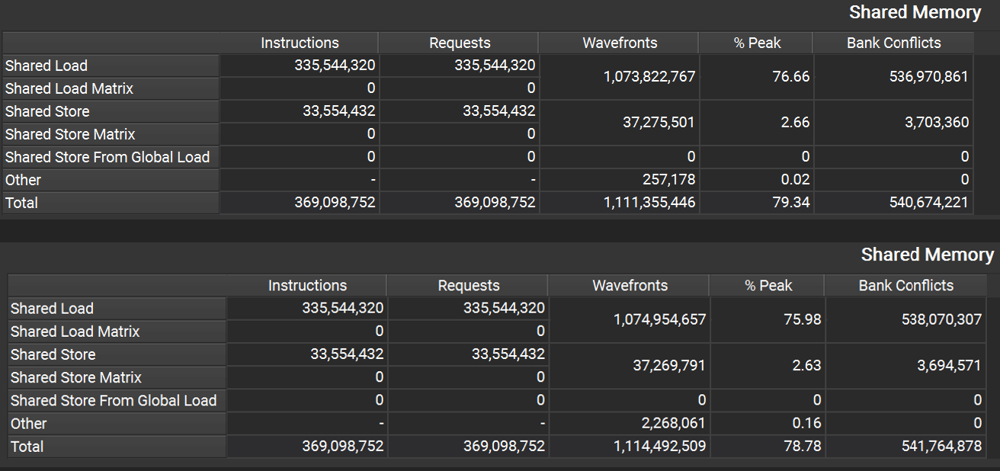

| Shared Load 指标 | GEMM4 | GEMM5 |
| --- | ---: | ---: |
| 加载请求数（LDS） | 335,544,320 | 335,544,320 |
| SMEM 吞吐占峰值（% Peak） | 76.66% | 75.98% |
| Bank Conflicts | 536,970,861 | 538,070,307 |

NCU 印证了这一点：两版 Shared Load 的 LDS 请求数一字不差（335,544,320），SMEM 吞吐占峰值均为约 76%，连 bank 冲突也几乎相同。SASS 层面没有可观测差异，性能持平。

>因为编译器辅助优化的原因，不是每一版的性能都有明显提升，但这不妨碍每版代码的教学意义。这种 "先放寄存器，再做 FMA" 的内层结构，是之后每个版本的基础。

<br>

## GEMM6：全局访存 float4 向量化

到目前为止，A/B 从全局到 shared 的搬运都是按 float 单个搬的。

每个 float（4字节）占用一条加载指令（LDG），4 字节的元素用一条 32 位的加载指令，效率不高。

CUDA 支持 `float4`，一条指令搬 16 字节（硬件对应 LDG.128 / STG.128），搬同样数据所需的指令数从 4 条降到 1 条（需地址 16 字节对齐，且矩阵尺寸能被 4 整除）。

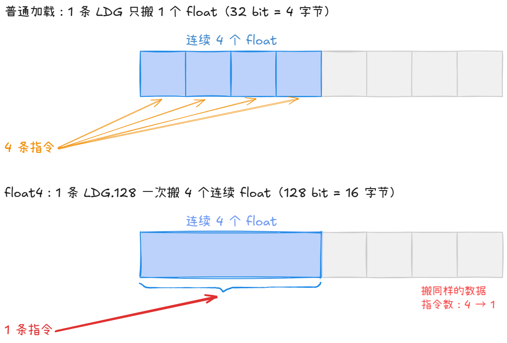

**实现**：
- 全局 → shared 的循环改写成按 float4 展开。
- shared → 全局 的写回也用 float4。

```cpp
__global__ void GEMM6(float* C, const float* A, const float* B, int M, int N, int K) {
    constexpr int BK = 32, BM = 128, BN = 128, TM = 8, TN = 8;
    __shared__ float Ads[BM][BK];
    __shared__ float Bds[BK][BN];
    int ty = threadIdx.y, tx = threadIdx.x;
    int tid = ty * blockDim.x + tx;
    float val[TM][TN] = {0.0f};

    for (int tile = 0; tile < K; tile += BK) {
        // 使用 float4 向量化加载 A，减少访存指令
        for (int i = tid; i < BM * (BK / 4); i += blockDim.x * blockDim.y) {
            // i 是 float4 的索引，k 是 float4 的起始列号，k 一定是 4 的倍数
            int m = i / (BK / 4), k = (i % (BK / 4)) * 4;
            *(float4*)&Ads[m][k] = *(const float4*)&A[(blockIdx.y * BM + m) * K + tile + k];
        }
        // 使用 float4 向量化加载 B，减少访存指令
        for (int i = tid; i < BK * (BN / 4); i += blockDim.x * blockDim.y) {
            int k = i / (BN / 4), n = (i % (BN / 4)) * 4;
            *(float4*)&Bds[k][n] = *(const float4*)&B[(tile + k) * N + blockIdx.x * BN + n];
        }
        __syncthreads();

        // 本版计算阶段依然用标量
        for (int k = 0; k < BK; k++) {
            float b_val[TN];
            for (int j = 0; j < TN; j++)
                b_val[j] = Bds[k][tx * TN + j];
            for (int i = 0; i < TM; i++) {
                float a_val = Ads[ty * TM + i][k];
                for (int j = 0; j < TN; j++)
                    val[i][j] += a_val * b_val[j];
            }
        }
        __syncthreads();
    }

    // 使用 float4 向量化写回 C
    for (int i = 0; i < TM; i++)
        for (int j = 0; j < TN; j += 4) {
            float4 v = {val[i][j], val[i][j+1], val[i][j+2], val[i][j+3]};
            *(float4*)&C[(blockIdx.y * BM + ty * TM + i) * N + blockIdx.x * BN + tx * TN + j] = v;
        }
}
```

**收益**：
- 每个线程发出的访存指令数减少到原来的 1/4（4 条 LDG 变 1 条 LDG.128），
- 减轻 load/store 单元的发射压力，也让 SM 有更多指令槽留给 FMA。

| 版本 | 耗时(ms) | TFLOPS | 占cuBLAS % |
| --- | ---: | ---: | ---: |
| GEMM5 | 21.00 | 6.55 | 66.5% |
| GEMM6 | 20.88 | 6.58 | 66.8% |

> 所有尺寸的 GEMM6 经向量化优化后，性能数据均比 GEMM5 有显著提升，唯有这 4096 尺寸下，GEMM6 版本未见明显变化。查询了 SASS，GEMM5 加载和写回用的是 LDG.E 和 STG.E，GEMM6 用的是 STG.E.128 和 LDG.E.128，加载与写回指令确实减少，说明优化本身是生效的。可能是 4096 尺寸下编译器把 GEMM5 的代码调度到了异常好的状态，计算已能掩盖住全局加载，指令不是关键瓶颈。（我相信计算机没有秘密，然时间有限，不愿在此点上继续深究）


## GEMM6B：计算阶段 float4

**GEMM6** 只向量化了访存阶段，计算阶段依然是标量加载（一条 LDS 读 4 字节）。

本版不改变任何布局、不引入 bank conflict，只在计算阶段把 Bds 的加载改成 float4 向量化，

Ads 的加载不使用 float4，因为 Ads[ty * TM + i][k] 里 i 是行方向，跨 BK 个步长，不连续，无法用一条 float4 指令加载。

```cpp
// 仅改动计算阶段
for (int k = 0; k < BK; k++) {
    // B 侧每 4 个 j 用一条 float4 读取，把 LDS 指令数压到 1/4
    float4 b_val4[TN / 4];
    for (int j = 0; j < TN; j += 4)
        b_val4[j / 4] = *(const float4*)&Bds[k][tx * TN + j];
    for (int i = 0; i < TM; i++) {
        float a_val = Ads[ty * TM + i][k];
        for (int j = 0; j < TN; j += 4) {
            val[i][j + 0] += a_val * b_val4[j / 4].x;
            val[i][j + 1] += a_val * b_val4[j / 4].y;
            val[i][j + 2] += a_val * b_val4[j / 4].z;
            val[i][j + 3] += a_val * b_val4[j / 4].w;
        }
    }
}
__syncthreads();
```

SASS（计算阶段，原B侧 LDS → LDS.128）：

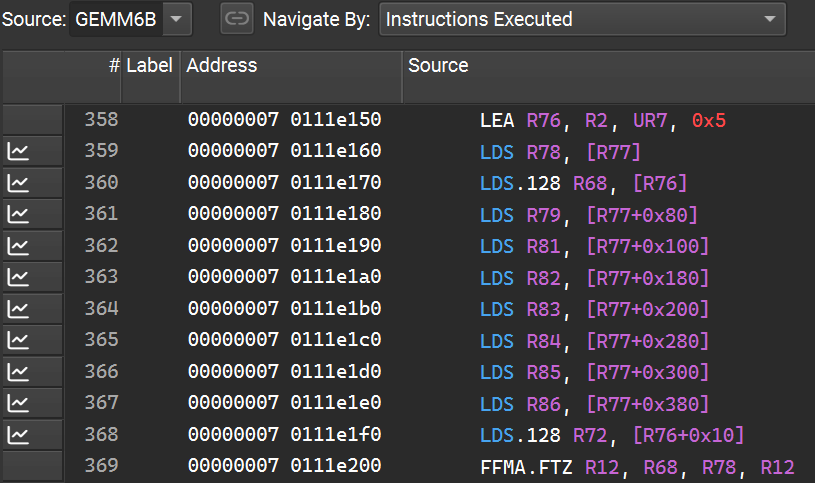

```
LDS R.., [R77]           // A 侧标量读（跨行，不连续，无法合并，还是LDS）
LDS.128 R.., [R76]       // B 侧 8 个连续元素 → 编译器自动合并成 2 条 128 位
LDS R.., [R77+0x80*i]    // A 侧其余 7 个
LDS.128 R.., [R76+0x10]
FFMA
```

| 版本 | 耗时(ms) | TFLOPS | 占cuBLAS % |
| --- | ---: | ---: | ---: |
| GEMM6 | 20.88 | 6.58 | 66.8% |
| GEMM6B | 18.58 | 7.40 | 75.1% |

<br>

## 关于共享内存 Bank 冲突（GEMM7、GEMM7B、GEMM8）

共享内存被组织成 32 个 bank。一个 warp 访问共享内存时，如果 32 个线程落在 32 个不同 bank，一次就能取完；如果有多个线程落在同一个 bank，硬件只能把它们串行化排队执行，叫 **bank conflict**。

>冲突路数 = 同一 bank 上串行的线程数量，n 路冲突意味着吞吐量掉到理论值的 1/n。


### 附：什么是 wavefront？NCU 的"几路冲突"怎么算？

读本文后面 NCU 冲突数字前，先讲一段前置知识：wavefront（波）和 way（路）数的是什么?

> 若不打算深究 NCU 可跳过这段内容。

**1. 一条指令 = 32 个线程同时执行（SIMT）**

GPU 的一条指令不是 1 个线程在执行，而是一个 warp（32 个线程）同时执行。在算"一次访问"时，要算 32 份。

**2. 每个线程拿多少字节？**

| 指令 | 每个线程拿 | 32 个线程一共要拿 |
| --- | ---: | ---: |
| LDS（32 位，标量）| 4B（1 个 float） | 128B |
| LDS.128（float4） | 16B（4 个 float） | 512B |

**3. 共享内存每周期最多能吐出多少？**

共享内存有 32 个 bank，每 bank 每周期只能输出 4B（容量如此）。一个周期内，整个共享内存最多输出 32 × 4B = 128B。此乃硬件规格。

**4. 需求 ÷ 供给 = 要几趟**

| 指令 | 总需求 | 每周期供给 | 趟数 |
| --- | ---: | ---: | ---: |
| 标量 | 128B | 128B | 1 趟 |
| float4 | 512B | 128B | 4 趟 |

float4 要搬的数据量（512B）超过硬件单周期的极限（128B），必须分 4 趟，**每一趟就是一个 wavefront（波）**。

标量访问时 32 个线程刚好一趟；128 位访问时拆成 8 个线程一趟（128B ÷ 16B）。

**5. NCU 的 way 怎么算？**

NCU 报冲突用的单位 way = 实际 wavefronts ÷ 请求数。它的**零点（无冲突基准）不是 0，而是随指令宽度变**：

| 指令 | 无冲突时 | NCU 显示 |
| --- | ---: | ---: |
| 标量 LDS | 1 趟/请求 | 1.0-way |
| LDS.128 | 4 趟/请求 | 4.0-way |

读 NCU 数字时，应把 way 和指令宽度对应起来看：**4.0-way 对应 128 位访问时 = 无冲突**（不是 4 路冲突）；如果混合了不同指令宽度的核（既有标量又有float4），128 位的 way 数不能和标量的 way 数直接对比。此时 way 数是各自与自身零点比较的混合平均。

**最后：冲突只算同一波内部。** 同一波请求中有线程落在同一个 bank，形成冲突，硬件要多花周期；不同波之间落在同一 bank 不算冲突（不同周期处理，不排队）。

<br>

## GEMM7：转置布局（特意保留的反面教材）

**动机**：GEMM6B 已经量化过：计算阶段用 float4 能带来一点提升。而且 GEMM6B 的计算阶段只在读 Bds 时使用了 float4，读 Ads 还是用的标量，那如果把 Ads 也改成用 float4 读，能不能再提升一点性能呢？

既然 float4 要求数据沿连续的方向存储，一个自然的想法就是："把 Bds 的布局从 `[BK][BN]` 改成 `[BN][BK]`，这样就和 Ads 的布局一致，两者都沿 K 连续，计算阶段都可以用 float4 读取共享内存了。"

```cpp
__global__ void GEMM7(float* C, const float* A, const float* B, int M, int N, int K) {
    constexpr int BK = 32, BM = 128, BN = 128, TM = 8, TN = 8;
    __shared__ float Ads[BM][BK];
    // 本版核心：B 在 shared 里改成 [BN][BK] 布局，沿 k 方向连续，才能用 float4 读
    // 代价是计算阶段会出现 bank conflict
    __shared__ float Bds[BN][BK];
    int ty = threadIdx.y, tx = threadIdx.x;
    int tid = ty * blockDim.x + tx;
    float val[TM][TN] = {0.0f};

    for (int tile = 0; tile < K; tile += BK) {
        // A：直接 float4 加载到 Ads[BM][BK]
        for (int i = tid; i < BM * (BK / 4); i += blockDim.x * blockDim.y) {
            int m = i / (BK / 4), k = (i % (BK / 4)) * 4;
            *(float4*)&Ads[m][k] = *(const float4*)&A[(blockIdx.y * BM + m) * K + tile + k];
        }
        // B：从全局 B(K, N) 读取连续 n 方向的 float4，写入 shared 时转置为 Bds[BN][BK]
        // 此处会产生 bank conflict（所有线程命中同一列 k）
        for (int i = tid; i < BK * (BN / 4); i += blockDim.x * blockDim.y) {
            int k = i / (BN / 4), n = (i % (BN / 4)) * 4;
            float4 v = *(const float4*)&B[(tile + k) * N + blockIdx.x * BN + n];
            Bds[n + 0][k] = v.x;
            Bds[n + 1][k] = v.y;
            Bds[n + 2][k] = v.z;
            Bds[n + 3][k] = v.w;
        }
        __syncthreads();

        // 朴素 k 访问：同一时刻所有线程读同一列 k（行号不同、列号相同），命中同一个 bank
        for (int k = 0; k < BK; k += 4) {
            float4 b_val[TN];
            for (int j = 0; j < TN; j++)
                b_val[j] = *(const float4*)&Bds[tx * TN + j][k];
            for (int i = 0; i < TM; i++) {
                float4 a_val = *(const float4*)&Ads[ty * TM + i][k];
                for (int j = 0; j < TN; j++) {
                    val[i][j] += a_val.x * b_val[j].x;
                    val[i][j] += a_val.y * b_val[j].y;
                    val[i][j] += a_val.z * b_val[j].z;
                    val[i][j] += a_val.w * b_val[j].w;
                }
            }
        }
        __syncthreads();
    }

    for (int i = 0; i < TM; i++)
        for (int j = 0; j < TN; j += 4) {
            float4 v = {val[i][j], val[i][j+1], val[i][j+2], val[i][j+3]};
            *(float4*)&C[(blockIdx.y * BM + ty * TM + i) * N + blockIdx.x * BN + tx * TN + j] = v;
        }
}
```

然而代价随之而来...

| 版本 | 耗时(ms) | TFLOPS | 占cuBLAS % |
| --- | ---: | ---: | ---: |
| GEMM6B | 18.58 | 7.40 | 75.1% |
| GEMM7 | 42.32 | 3.25 | 33.0% |

#### 为什么性能暴跌？

用 NCU 定位，问题出在共享内存 Bank 冲突（上：GEMM6B，下：GEMM7）：

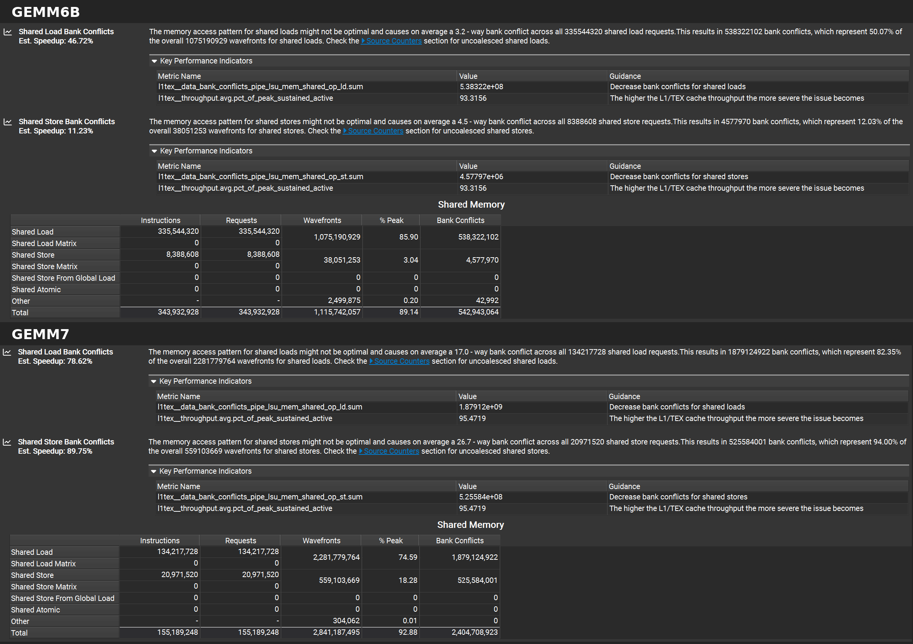

| | GEMM6B | GEMM7 |
| --- | ---: | ---: |
| 计算读指令 | LDS.128 + LDS.32 混合 | 全 LDS.128 |
| Shared Load 平均冲突 | 3.2-way | 17.0-way |
| Shared Load 冲突 wavefronts 占比 | 50.07% | 82.35% |
| Shared Store 平均冲突 | 4.5-way | 26.7-way |
| Shared Store 冲突 wavefronts 占比 | 12.03% | 94.00% |

> **口径**：NCU 的 way = 实际波数 ÷ 请求数，且是混合平均 —— 比如 GEMM7 的 26.7 = A 侧写（约 4-way）与 B 侧写（32-way）的加权平均；17.0 = B 侧读（每条约 32 波）与 A 侧读（每条 4 波）的平均。

**为什么加载写入会冲突（26.7-way）？**
warp 内 32 个线程写 `Bds[n][k]` 时，是**同一列、不同行**。而 bank 只看列号：行宽 32 是 bank 周期（32）的整数倍，行号 n 取余数后被消掉——所以 32 个地址不同的请求全挤在同一个 bank 上排队，形成 32-way。

**为什么计算读取会冲突（17.0-way）？**
同一个根源：读 `Bds[tx*TN+j][k]` 也是**同一列、不同行**，32 个线程全挤在同一列上。float4 占 4 个 bank，每个 bank 排 32 个请求，一条指令拆 32 波（无冲突只要 4 波）；A 侧读无冲突，混合平均后 NCU 报 17.0-way。

#### 作为对比，看看改前的 GEMM6B —— 为什么它只有 3.2 / 4.5-way？

GEMM6B 的 `Bds[k][n]` 是 `[32][128]`，行宽 128 同样是 32 的倍数 → 同样 "bank 只看列号"。区别在**列号怎么变**：

| | GEMM6B | GEMM7 |
| --- | --- | --- |
| Bds 布局 | [32][128] | [128][32] |
| 访问形态 | 同一行、不同列（列号随线程错开） | 不同行、同一列（列号不随线程变） |
| Load/Store 冲突 | 3.2 / 4.5-way | 17.0 / 26.7-way |

一个访问错开；一个集中撞壁。同样的行宽尺寸，冲突程度天差地别。

> bank conflict 是隐蔽的性能杀手，改布局需特别注意。

## GEMM7B：k_offset 循环移位（消除计算阶段的冲突）

GEMM7 已经把 B 布局改成了 [BN][BK]。既然引起了冲突，就来消除冲突，本版在不放弃这个布局的前提下，尝试把它带来的冲突修掉。

首先只看**计算阶段**的冲突：GEMM7 冲突根源之一是"warp 内所有线程访问相同的 k 列"，如果让不同线程从不同的 k 开始访问，访问就能分散到不同的 bank。

**实现**：和 GEMM7 相比只改一处：计算循环里 k 的起点：
```cpp
// GEMM7：
for (int k = 0; k < BK; k += 4) {}

// GEMM7B：用 k_offset 旋转，wavefront 内 8 个线程从不同的 k 开始，打散 bank
for (int k_offset = tid * 4; k_offset < BK + tid * 4; k_offset += 4) {
    int k = k_offset % BK;
    // ...其他代码全部一样
}
```

**NCU 截图：**

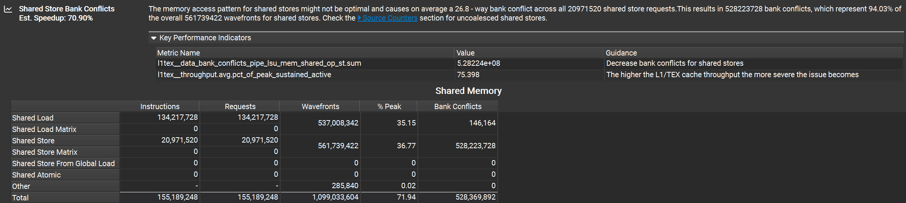

| | GEMM7 | GEMM7B |
| --- | ---: | ---: |
| Shared Load 平均冲突 | 17.0-way | 4.0-way（无冲突） |
| Shared Store 平均冲突 | 26.7-way | 26.8-way |

`k = (tid×4) % 32`，硬件把 128 位访问按 8 线程 wavefront 执行。一个 wavefront 内 8 个线程的 k 恰好是 0、4、8、…28，每个线程读 k~k+3，8 个线程正好覆盖全部 32 个 bank → 每个 wavefront 内无冲突。NCU 实测计算段冲突从 17.0-way 降到 4.0-way（4.0 就是 128 位访问的无冲突基准，冲突数接近 0）：

| 版本 | 耗时(ms) | TFLOPS | 占cuBLAS % |
| --- | ---: | ---: | ---: |
| GEMM6B | 18.58 | 7.40 | 75.1% |
| GEMM7 | 42.32 | 3.25 | 33.0% |
| GEMM7B | 21.29 | 6.46 | 65.6% |

k_offset 只解决了计算阶段的冲突，加载阶段转置写入 `Bds[BN][BK]` 的代码一字未改（旧疾未除），仍是 32 路冲突（NCU 实测 26.8-way，与 GEMM7 几乎一样）。

加载阶段 GEMM7B 依然比 GEMM6B 慢得多（26.8-way vs 4.5-way），修复计算阶段冲突后，整体性能（21.29 ms）仍低于 GEMM6B（18.58 ms）。

> 本版作为过渡，下一版 GEMM8 用 XOR Swizzle 同时消除加载与计算两个阶段的冲突，是更常用的技术。

<br>

## GEMM8：Swizzle 解决 Bank 冲突

**回顾**：GEMM7 把 B 矩阵在共享内存里转置存储（Bds[BN][BK]，为了计算阶段沿 k 连续、能用 float4 读），但转置后读写时，同一列 k 的元素落在同一个 Bank 上，造成严重冲突。

### 关于 Swizzle：

Swizzle 是一种地址重排技巧 —— 逻辑上矩阵还是原来的布局，但物理存储位置通过 XOR 打乱，让同一列的元素落在不同的 Bank 上。

**Swizzle 以 16 字节（128 bit） 为最小单位重排：**
- 一个 float4（16B） 里的数据在 GMEM 和 SMEM 里都是连续的（内部不打乱）
- Swizzle 只在 float4 块之间重排顺序（一行 32 个 float = 8 个 float4 块）

> 粒度取 float4 而不是单个 float，是为了不破坏向量化读写的对齐（列号总是 4 的倍数）

**Swizzle 的地址变换公式：**

> 本仓库的 swizzle 接收行号 n 和列号 k（k 是 4 的倍数），返回搅乱后的新列号：

```cpp
auto swizzle = [](int n, int k) {
    int c   = k / 4;                // 算 k 在第几块 float4 里（0~7）
    int off = k % 4;                // 算 k 在块里是第几个元素（0~3）
    int sc  = c ^ ((n / 8) % 8);    // 把行号的指纹（0~7）异或进块号（搅乱）
    return sc * 4 + off;            // 拼回最终的列号（仍是 4 的倍数）
};
```

> 总结一句话：把 `行号每 8 行一组的指纹 (n/8)%8` 和 `列号所在的块号 k/4` 做 XOR，让同一列、不同行的元素落到不同的 Bank。

**为什么用 XOR（^）？**
- 不越界：k/4 和指纹都在 0~7，异或结果仍在 07（若用加法，c+7 算出 14，得再取模）；
- 指纹不同 → 结果必不同：不同的指纹 XOR 同一个 k/4 一定得到不同的块号，不会互相挤占。

**完整代码：**

```cpp
__global__ void GEMM8(float* C, const float* A, const float* B, int M, int N, int K) {
    constexpr int BK = 32, BM = 128, BN = 128, TM = 8, TN = 8;
    __shared__ float Ads[BM][BK];
    // 保持 [BN][BK] 布局，计算阶段才能用 float4 读连续 k
    __shared__ float Bds[BN][BK];
    int ty = threadIdx.y, tx = threadIdx.x;
    int tid = ty * blockDim.x + tx;

    // 本版核心：XOR Swizzle 地址映射，以 float4 为粒度，不破坏对齐
    // 输入：n 行号（BN 方向），k 列号（BK 方向，4 的倍数）
    // 输出：搅乱后的新列号，仍是 4 的倍数，float4 读取仍对齐
    auto swizzle = [](int n, int k) {
        int c   = k >> 2;               // 算 k 在第几块 float4 里（0~7）
        int off = k & 3;                // 算 k 在块里是第几个元素（0~3）
        int sc  = c ^ ((n >> 3) & 7);   // 用行号把列块号搅乱
        return (sc << 2) | off;         // 拼回最终的列号（仍是 4 的倍数）
    };

    float val[TM][TN] = {0.0f};
    for (int tile = 0; tile < K; tile += BK) {
        // A：float4 加载到 Ads[BM][BK]，无 swizzle
        // A 侧本来就没有冲突，加 swizzle 没收益还多一次映射，所以不加
        for (int i = tid; i < BM * (BK / 4); i += blockDim.x * blockDim.y) {
            int m = i / (BK / 4), k = (i % (BK / 4)) * 4;
            *(float4*)&Ads[m][k] = *(const float4*)&A[(blockIdx.y * BM + m) * K + tile + k];
        }
        // B：全局读 float4（n 方向连续），写入 shared 时转置为 Bds[BN][BK]
        // 写入地址套上 swizzle，把原来 32-way 的转置写入冲突降到 4-way
        for (int i = tid; i < BK * (BN / 4); i += blockDim.x * blockDim.y) {
            int k = i / (BN / 4), n = (i % (BN / 4)) * 4;
            float4 v = *(const float4*)&B[(tile + k) * N + blockIdx.x * BN + n];
            // 因为 n..n+3 的 (n+d)>>3 相同，swizzle 值一样，只算一次
            int s = swizzle(n, k);
            Bds[n + 0][s] = v.x;
            Bds[n + 1][s] = v.y;
            Bds[n + 2][s] = v.z;
            Bds[n + 3][s] = v.w;
        }
        __syncthreads();

        // 计算阶段：本版删除 k_offset，改回普通 k = 0~BK 遍历（swizzle 已经让相同 k 在不同 n 上落到不同 bank，不需要旋转 k 起点）
        for (int k = 0; k < BK; k += 4) {
            float4 b_val[TN];
            for (int j = 0; j < TN; j++)
                b_val[j] = *(const float4*)&Bds[tx * TN + j][swizzle(tx * TN + j, k)];
            for (int i = 0; i < TM; i++) {
                float4 a_val = *(const float4*)&Ads[ty * TM + i][k];
                for (int j = 0; j < TN; j++) {
                    val[i][j] += a_val.x * b_val[j].x;
                    val[i][j] += a_val.y * b_val[j].y;
                    val[i][j] += a_val.z * b_val[j].z;
                    val[i][j] += a_val.w * b_val[j].w;
                }
            }
        }
        __syncthreads();
    }

    for (int i = 0; i < TM; i++)
        for (int j = 0; j < TN; j += 4) {
            float4 v = {val[i][j], val[i][j+1], val[i][j+2], val[i][j+3]};
            *(float4*)&C[(blockIdx.y * BM + ty * TM + i) * N + blockIdx.x * BN + tx * TN + j] = v;
        }
}
```

**GEMM8 NCU 截图：**

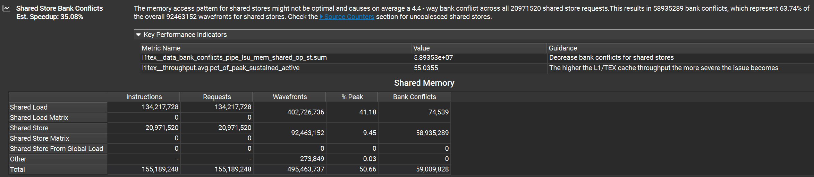

| 版本 | Load 冲突 | Store 冲突 | 说明 |
| --- | ---: | ---: | ---: |
| GEMM6B | 3.2-way | 4.5-way | float4 向量化 |
| GEMM7 | 17.0-way | 26.7-way | B 转置布局反例 |
| GEMM7B | 4.0-way | 26.8-way | k_offset 修复读侧 |
| **GEMM8** | **3.0-way** | **4.4-way** | **swizzle 修复两侧** |

> NCU 的 way = wavefronts ÷ requests

**GEMM8：读侧冲突基本消失，写侧贴近粒度底线**

**Load 3.0-way**：全部 402,726,736 个 wavefront 中只有 74,539 个发生冲突，占 0.02%——冲突可以认为消失了。3.0 低于 128 位访问的自然值 4.0，是因为 a_val 同地址读被硬件广播合并，摊低了平均。

**Store 4.4-way**：写侧是**标量**转置写（STS.32），一条指令 32 个请求，而 swizzle 可供重排的位置是 8 个（一行 32 个 float = 8 个 float4 块），32 个请求最少也要挤 8 个位置（32 ÷ 8 = 4），所以 4-way 是标量写的底线，4.4 已经贴在底线上。

| 版本 | 耗时(ms) | TFLOPS | 占cuBLAS % |
| --- | ---: | ---: | ---: |
| GEMM6B | 18.58 | 7.40 | 75.1% |
| GEMM7 | 42.32 | 3.25 | 33.0% |
| GEMM7B | 21.29 | 6.46 | 65.6% |
| GEMM8 | 16.27 | 8.45 | 85.8% |

> 现在 GEMM8 既可以在计算阶段用 float4，也不再引发强烈冲突。性能在非双缓冲的版本里达到最高。

<br>

## GEMM9：朴素双缓冲

到目前为止，所有算子的流程都是"加载 → 同步 → 计算 → 同步"，加载和计算是串行的。SM 在加载时计算闲置、在计算时全局内存闲置。硬件的加载单元和计算单元本来是独立的，如果能让它们一起开工，计算单元算这一份的同时加载单元搬下一份，两边就都忙起来。

**实现**：

共享内存开两份缓冲区（buf_0 和 buf_1），目标是在计算当前 tile 的同时预取下一个 tile，把内存访问与计算重叠起来。两份 buffer 交替使用（ping-pong）。

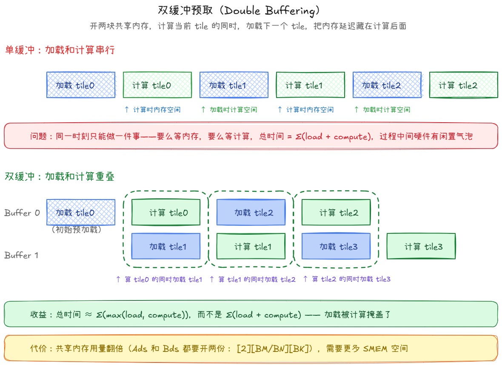

> 共享内存翻倍到 64 KB，需要用 `cudaFuncSetAttribute` 提高单 block 动态共享内存上限。

```cpp
void launch_GEMM9(float* C, const float* A, const float* B, int M, int N, int K) {
    dim3 block(16, 16);
    dim3 grid(ceil_div(N, 128), ceil_div(M, 128));
    constexpr size_t smem_size = (2 * 128 * 32 + 2 * 128 * 32) * sizeof(float);  // 32 KB + 32 KB = 64 KB
    static bool attr_ready = false;
    if (!attr_ready) {
        cudaFuncSetAttribute(GEMM9, cudaFuncAttributeMaxDynamicSharedMemorySize, smem_size);
        attr_ready = true;
    }
    GEMM9<<<grid, block, smem_size>>>(C, A, B, M, N, K);
    cudaCheck(cudaGetLastError());
}
```

```cpp
__global__ void GEMM9(float* C, const float* A, const float* B, int M, int N, int K) {
    constexpr int BK = 32, BM = 128, BN = 128, TM = 8, TN = 8;
    extern __shared__ char smem[];
    // shared memory 开两份 buffer，这是本版核心：
    // Ads/Bds 的第一维大小 2 是双缓冲 buffer 维度
    auto& Ads = *reinterpret_cast<float (*)[2][BM][BK]>(smem);
    auto& Bds = *reinterpret_cast<float (*)[2][BN][BK]>(smem + 2 * BM * BK * sizeof(float));
    int ty = threadIdx.y, tx = threadIdx.x;
    int tid = ty * blockDim.x + tx;
    auto swizzle = [](int n, int k) {
        int c   = k >> 2;
        int off = k & 3;
        int sc  = c ^ ((n >> 3) & 7);
        return (sc << 2) | off;
    };
    float val[TM][TN] = {0.0f};
    int buf = 0;  // 当前计算用的 buffer 索引，加载下一 tile 时切换到另一个

    // 预加载 tile 0 到 buf 0
    for (int i = tid; i < BM * (BK / 4); i += blockDim.x * blockDim.y) {
        int m = i / (BK / 4), k = (i % (BK / 4)) * 4;
        *(float4*)&Ads[0][m][k] = *(const float4*)&A[(blockIdx.y * BM + m) * K + k];
    }
    for (int i = tid; i < BK * (BN / 4); i += blockDim.x * blockDim.y) {
        int k = i / (BN / 4), n = (i % (BN / 4)) * 4;
        float4 v = *(const float4*)&B[k * N + blockIdx.x * BN + n];
        int s = swizzle(n, k);
        Bds[0][n + 0][s] = v.x;
        Bds[0][n + 1][s] = v.y;
        Bds[0][n + 2][s] = v.z;
        Bds[0][n + 3][s] = v.w;
    }
    __syncthreads();

    // 主循环：预加载下一 tile，计算当前 tile
    for (int tile = 0; tile < K; tile += BK) {
        int next_tile = tile + BK;
        int next_buf = 1 - buf;
        // 加载下一 tile 到 next_buf
        if (next_tile < K) {
            for (int i = tid; i < BM * (BK / 4); i += blockDim.x * blockDim.y) {
                int m = i / (BK / 4), k = (i % (BK / 4)) * 4;
                *(float4*)&Ads[next_buf][m][k] = *(const float4*)&A[(blockIdx.y * BM + m) * K + next_tile + k];
            }
            for (int i = tid; i < BK * (BN / 4); i += blockDim.x * blockDim.y) {
                int k = i / (BN / 4), n = (i % (BN / 4)) * 4;
                float4 v = *(const float4*)&B[(next_tile + k) * N + blockIdx.x * BN + n];
                int s = swizzle(n, k);
                Bds[next_buf][n + 0][s] = v.x;
                Bds[next_buf][n + 1][s] = v.y;
                Bds[next_buf][n + 2][s] = v.z;
                Bds[next_buf][n + 3][s] = v.w;
            }
        }
        // 计算当前 tile
        for (int k = 0; k < BK; k += 4) {
            float4 b_val[TN];
            for (int j = 0; j < TN; j++)
                b_val[j] = *(const float4*)&Bds[buf][tx * TN + j][swizzle(tx * TN + j, k)];
            for (int i = 0; i < TM; i++) {
                float4 a_val = *(const float4*)&Ads[buf][ty * TM + i][k];
                for (int j = 0; j < TN; j++) {
                    val[i][j] += a_val.x * b_val[j].x;
                    val[i][j] += a_val.y * b_val[j].y;
                    val[i][j] += a_val.z * b_val[j].z;
                    val[i][j] += a_val.w * b_val[j].w;
                }
            }
        }
        __syncthreads();
        buf = next_buf;  // 切换 buffer，下一轮用刚加载好的那份
    }

    for (int i = 0; i < TM; i++)
        for (int j = 0; j < TN; j += 4) {
            float4 v = {val[i][j], val[i][j+1], val[i][j+2], val[i][j+3]};
            *(float4*)&C[(blockIdx.y * BM + ty * TM + i) * N + blockIdx.x * BN + tx * TN + j] = v;
        }
}
```

| 版本 | 耗时(ms) | TFLOPS | 占cuBLAS % |
| --- | ---: | ---: | ---: |
| GEMM8 | 16.27 | 8.45 | 85.8% |
| GEMM9 | 20.59 | 6.68 | 67.8% |

### 为什么 GEMM9 反而变慢了？

> 首先说明，本版代码**只演示双缓冲的结构**，代码里的加载和计算指令在硬件层面仍是串行关系，不是真正意义上的异步（真异步 cp.async 在下版讲），改版写了双缓冲不等于有真正的流水线（真流水在后面版本讲）。

**1.先排除 bank 冲突的嫌疑：**

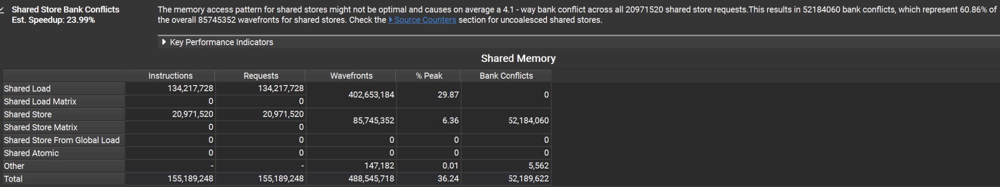

Load 冲突：0；Store 冲突：4.1-way。GEMM9 甚至更干净（swizzle 没被破坏）。

**2.再来看 Occupancy（占用率），共享内存翻倍后占用率是否下降：**

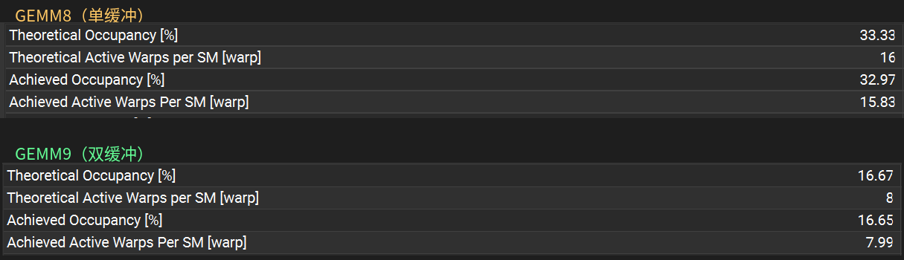

| 版本 | 理论占用率 | 实测活跃 warp |
| --- | ---: | ---: |
| GEMM8 | 33.33%（16 warp/SM） | 15.83（≈32.97%） |
| GEMM9 | 16.67%（8 warp/SM） | 7.99（≈16.65%） |

每 SM 的 warp 直接减半，理论和实测一致 —— 占用率减半

**3.最后看 Warp State：**

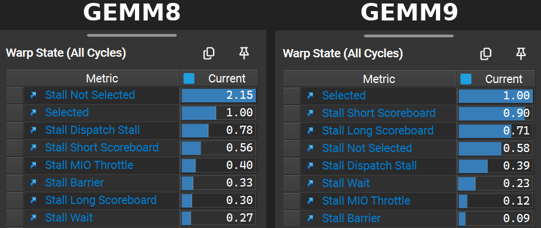

|Stall | GEMM8 | GEMM9 |
| --- | ---: | ---: |
| Long Scoreboard（等全局数据） | 0.30 | 0.71 |
| Short Scoreboard（等共享内存） | 0.56 | 0.90 |
| Barrier（等同步） | 0.33 | 0.09 |
| MIO Throttle（共享内存队列拥堵） | 0.40 | 0.12 |

warp 少了，等内存数据的 stall 全部上涨；Barrier 下降是双缓冲唯一兑现的收益（每 tile 1 次 sync vs 2 次）；MIO Throttle 下降说明共享内存带宽没用满。

**总结来说：没拿到异步的收益，又承担了占用率减半的代价，延迟暴露**

本版双缓冲加载和计算没有真正重叠，收益没兑现（如果编译器没帮忙的话）；而开两份 buffer 让共享内存翻倍、占用率砍半——原本靠 16 个 warp 切换隐藏延迟，现在只剩 8 个，于是 Long/Short Scoreboard 双双上涨，性能下降。

<br>

## GEMM9B：cp.async 双缓冲

**cp.async 是什么**：sm_80 引入的异步拷贝指令。一条指令把全局内存的 16 字节直接搬进共享内存 —— 不经过寄存器，warp 发出指令后立即继续执行，DMA 引擎在后台搬运。比方：普通加载是 "线程亲自取快递，取到才能接着干活"；cp.async 是 "填个快递单（发指令），由快递员（DMA）后台送，线程接着该干嘛干嘛"。

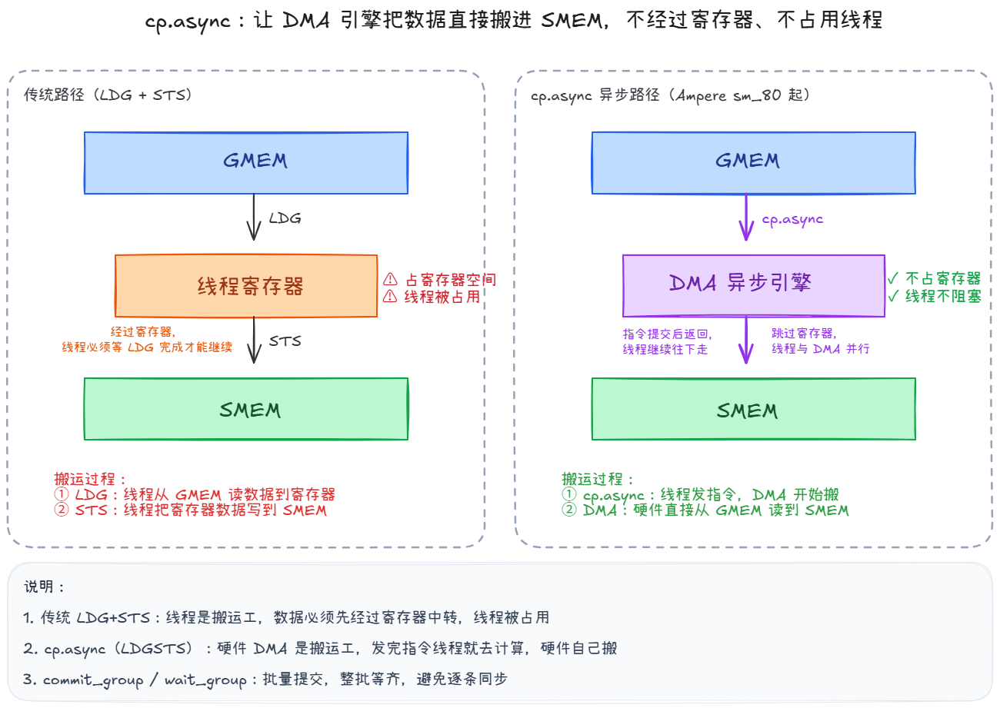

同步机制 `commit_group` / `wait_group`：指令发出 ≠ 数据到位。硬件用 "组" 管理流水进度：

```cpp
cp.async.commit_group;    // 把已发出的拷贝打包成一组
cp.async.wait_group N;    // 最多允许 N 组还没完成，其余必须完成
```

```cpp
__global__ void GEMM9B(float* C, const float* A, const float* B, int M, int N, int K) {
    constexpr int BK = 32, BM = 128, BN = 128, TM = 8, TN = 8;
    extern __shared__ char smem[];
    // 双缓冲结构与 GEMM9 相同
    auto& Ads = *reinterpret_cast<float (*)[2][BM][BK]>(smem);
    auto& Bds = *reinterpret_cast<float (*)[2][BN][BK]>(smem + 2 * BM * BK * sizeof(float));
    int ty = threadIdx.y, tx = threadIdx.x;
    int tid = ty * blockDim.x + tx;
    auto swizzle = [](int n, int k) {
        int c   = k >> 2;
        int off = k & 3;
        int sc  = c ^ ((n >> 3) & 7);
        return (sc << 2) | off;
    };
    float val[TM][TN] = {0.0f};
    int buf = 0;
    // 本版核心：用 cp.async 发出下一 tile 的加载，DMA 异步搬，不占 warp 指令发射
    auto load_tile_async = [&](int b, int tile) {  // b 是 buffer（0/1），tile 是 K 段
        // A 可以用 cp.async 直接拷贝
        for (int i = tid; i < BM * (BK / 4); i += blockDim.x * blockDim.y) {
            int m = i / (BK / 4), k = (i % (BK / 4)) * 4;
            asm volatile("cp.async.ca.shared.global [%0], [%1], 16;"
                : : "l"(&Ads[b][m][k]), "l"(&A[(blockIdx.y * BM + m) * K + tile + k]) : "memory");
        }
        // B 涉及转置，无法使用 cp.async 直接拷贝，用普通 float4 加载 + 共享内存写入转置（半流水的根源）
        for (int i = tid; i < BK * (BN / 4); i += blockDim.x * blockDim.y) {
            int k = i / (BN / 4), n = (i % (BN / 4)) * 4;
            float4 v = *(const float4*)&B[(tile + k) * N + blockIdx.x * BN + n];
            int s = swizzle(n, k);
            Bds[b][n + 0][s] = v.x;
            Bds[b][n + 1][s] = v.y;
            Bds[b][n + 2][s] = v.z;
            Bds[b][n + 3][s] = v.w;
        }
    };
    // 预加载 tile 0 并等待它全部到位
    load_tile_async(0, 0);
    asm volatile("cp.async.commit_group;" ::: "memory");
    asm volatile("cp.async.wait_group 0;" ::: "memory");
    __syncthreads();

    // 主循环：预加载下一 tile，计算当前 tile
    for (int tile = 0; tile < K; tile += BK) {
        int next_tile = tile + BK;
        int next_buf = 1 - buf;
        // 发出下一 tile 的异步拷贝，并提交为一组
        if (next_tile < K) {
            load_tile_async(next_buf, next_tile);
            asm volatile("cp.async.commit_group;" ::: "memory");
        }
        if (next_tile < K)
            asm volatile("cp.async.wait_group 1;" ::: "memory");  // wait_group 1：允许最新的 1 组（next tile）还没完成，其余组（current tile）必须完成
        else
            asm volatile("cp.async.wait_group 0;" ::: "memory");  // 最后一轮全等
        __syncthreads();
        // 计算当前 buf
        for (int k = 0; k < BK; k += 4) {
            float4 b_val[TN];
            for (int j = 0; j < TN; j++)
                b_val[j] = *(const float4*)&Bds[buf][tx * TN + j][swizzle(tx * TN + j, k)];
            for (int i = 0; i < TM; i++) {
                float4 a_val = *(const float4*)&Ads[buf][ty * TM + i][k];
                for (int j = 0; j < TN; j++) {
                    val[i][j] += a_val.x * b_val[j].x;
                    val[i][j] += a_val.y * b_val[j].y;
                    val[i][j] += a_val.z * b_val[j].z;
                    val[i][j] += a_val.w * b_val[j].w;
                }
            }
        }
        __syncthreads();
        buf = next_buf;
    }
    for (int i = 0; i < TM; i++)
        for (int j = 0; j < TN; j += 4) {
            float4 v = {val[i][j], val[i][j+1], val[i][j+2], val[i][j+3]};
            *(float4*)&C[(blockIdx.y * BM + ty * TM + i) * N + blockIdx.x * BN + tx * TN + j] = v;
        }
}
```

> 循环里为什么用 `wait_group 1`：处理 tile 时流水里恰好有两组在飞 —— 本轮刚提交的 next tile（允许没搬完，后台继续搬）和上一轮提交的 current tile（必须已就绪，马上就要算）。`wait_group 1` 的含义是 "最新 1 组可以没完成，其余必须完成"

**该版本只有半流水**：B 需要转置 + swizzle 才能写进共享内存，而 cp.async 只能做直线拷贝，所以 B 仍走 "LDG 到寄存器再 STS 写入" 的普通路径，真正异步的只有 A。因此 cp.async 的功能只发挥一半。

| 版本 | 耗时(ms) | TFLOPS | 占cuBLAS % |
| --- | ---: | ---: | ---: |
| GEMM9 | 20.59 | 6.68 | 67.8% |
| GEMM9B | 20.46 | 6.72 | 68.2% |

**注意**：性能提升微少，不是 cp.async 没有收益，而是 `-arch=native` 编译已经把 GEMM9 优化得很好，cp.async 能省的延迟不多。同一台 5060 Laptop，`-arch=sm_80` 编译时 GEMM9B 比 GEMM9 快 14~18%，提升明显，因为 Ampere 环境下，cp.async 的异步语义是实打实的，所有尺寸提升都非常明显。

**以下是 `-arch=sm_80` 编译时数据：**

| 尺寸 | GEMM9（占cuBLAS %） | GEMM9B（占cuBLAS %） | 提升 |
| --- | ---: | ---: | ---: |
| 1024 | 50.6% | 59.6% | +15.0% |
| 2048 | 63.7% | 74.0% | +13.9% |
| 3072 | 53.3% | 62.6% | +14.9% |
| 4096 | 49.7% | 60.8% | +18.3% |
| 5120 | 53.8% | 63.9% | +15.7% |
| 6144 | 53.6% | 65.1% | +17.7% |

<br>

### GEMM10：寄存器软件流水

承接 GEMM9（朴素双缓冲，不经编译器优化的样貌）—— GEMM9 虽然开了两份 buffer，但 "预取 next tile" 的整段代码排在 "计算 current tile" 前面，LDG 指令一口气全发完、STS 也跟着写完，warp 才进入计算。找不到加载与计算在硬件上交错的点，于是：
1. LDG 的数百周期全局延迟没有被任何计算覆盖，双缓冲写了却没形成流水；
2. 共享内存翻倍到 64KB，occupancy 还被拉低。

本版要解决的问题：不引入 cp.async，只靠指令调度，怎样让 "加载 next" 和 "计算 current" 两个步骤真正重叠。

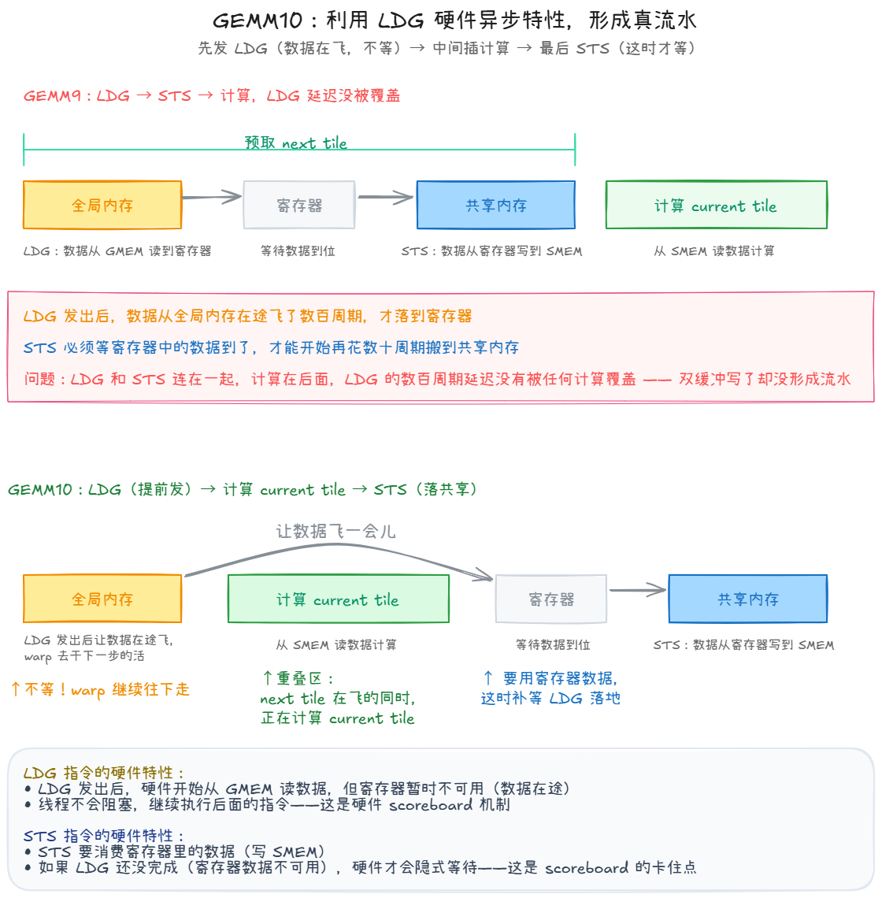

思路：把 "预取 next tile" 拆成两个动作，中间插计算
- issue_load()：  只发 LDG 把数据读进寄存器，warp 不等待数据返回，立即继续往下执行。
- commit_store()：等 current tile 全部算完后，再把寄存器里的数据 STS 落进共享内存。真正要用到寄存器中数据的这一刻，硬件才需要隐式等待 LDG 完成。

> 这利用了硬件 scoreboard 机制：GPU 用 scoreboard 跟踪 "哪些寄存器还在等数据"，**写寄存器时不阻塞，只有读它的时候才要等待它的数据到位**

**实现**：每轮主循环的顺序变成：
1. 发 next tile 的 LDG（A、B 都发，发完立即进入计算，数据在飞，线程不停那等）
2. 计算 current tile（LDG 的全局延迟被这段 FMA 计算覆盖）
3. next tile 落共享内存（大概率数据已到，最多补等剩余延迟）
4. __syncthreads，翻转 buffer，双缓冲流程继续

```cpp
__global__ void GEMM10(float* C, const float* A, const float* B, int M, int N, int K) {
    constexpr int BK = 32, BM = 128, BN = 128, TM = 8, TN = 8;
    extern __shared__ char smem[];
    auto& Ads = *reinterpret_cast<float (*)[2][BM][BK]>(smem);
    auto& Bds = *reinterpret_cast<float (*)[2][BN][BK]>(smem + 2 * BM * BK * sizeof(float));
    int ty = threadIdx.y, tx = threadIdx.x;
    int tid = ty * blockDim.x + tx;
    auto swizzle = [](int n, int k) {
        int c   = k >> 2;
        int off = k & 3;
        int sc  = c ^ ((n >> 3) & 7);
        return (sc << 2) | off;
    };
    float val[TM][TN] = {0.0f};
    int buf = 0;

    // 动作一：只发 LDG（数据进寄存器，不等！warp 立即继续）
    // 每线程 4+4 条 LDG（tile 大小 = BM×BK = 128×32 = 4096个 float = 1024个 float4，一个 block 共256个线程，每线程加载 1024/256 = 4 个 float4）
    auto issue_load = [&](float4* a_reg, float4* b_reg, int tile) {
        #pragma unroll
        for (int i = 0; i < 4; i++) {
            int idx = tid + i * 256;
            int m = idx / (BK / 4), k = (idx % (BK / 4)) * 4;
            a_reg[i] = *(const float4*)&A[(blockIdx.y * BM + m) * K + tile + k];
        }
        #pragma unroll
        for (int i = 0; i < 4; i++) {
            int idx = tid + i * 256;
            int k = idx / (BN / 4), n = (idx % (BN / 4)) * 4;
            b_reg[i] = *(const float4*)&B[(tile + k) * N + blockIdx.x * BN + n];
        }
    };
    // 动作二：把寄存器数据落入共享（这里真正消费 LDG 时才等；B 含转置 + swizzle）
    auto commit_store = [&](const float4* a_reg, const float4* b_reg, int b) {
        #pragma unroll
        for (int i = 0; i < 4; i++) {
            int idx = tid + i * 256;
            int m = idx / (BK / 4), k = (idx % (BK / 4)) * 4;
            *(float4*)&Ads[b][m][k] = a_reg[i];
        }
        #pragma unroll
        for (int i = 0; i < 4; i++) {
            int idx = tid + i * 256;
            int k = idx / (BN / 4), n = (idx % (BN / 4)) * 4;
            float4 v = b_reg[i];
            int s = swizzle(n, k);
            Bds[b][n + 0][s] = v.x;
            Bds[b][n + 1][s] = v.y;
            Bds[b][n + 2][s] = v.z;
            Bds[b][n + 3][s] = v.w;
        }
    };

    // 预加载 tile 0：LDG 发出 → 落入共享（首次等待不可避免，一次性成本）
    float4 a_reg[4], b_reg[4];
    issue_load(a_reg, b_reg, 0);
    commit_store(a_reg, b_reg, 0);
    __syncthreads();

    // 主循环：1.发 next tile 的 LDG → 2.计算 current tile → 3.next tile 落共享
    for (int tile = 0; tile < K; tile += BK) {
        int next_tile = tile + BK;
        int next_buf = 1 - buf;
        float4 a_next[4], b_next[4];
        // 1.提前发 next 的 LDG（不等，数据在途，warp 继续往下走）
        if (next_tile < K)
            issue_load(a_next, b_next, next_tile);
        // 2. 计算 current（LDG 延迟在此被覆盖）
        for (int k = 0; k < BK; k += 4) {
            float4 b_val[TN];
            for (int j = 0; j < TN; j++)
                b_val[j] = *(const float4*)&Bds[buf][tx * TN + j][swizzle(tx * TN + j, k)];
            for (int i = 0; i < TM; i++) {
                float4 a_val = *(const float4*)&Ads[buf][ty * TM + i][k];
                for (int j = 0; j < TN; j++) {
                    val[i][j] += a_val.x * b_val[j].x;
                    val[i][j] += a_val.y * b_val[j].y;
                    val[i][j] += a_val.z * b_val[j].z;
                    val[i][j] += a_val.w * b_val[j].w;
                }
            }
        }
        // 3. next 落共享（LDG 大概率已到；未到则只补等剩余延迟）
        if (next_tile < K)
            commit_store(a_next, b_next, next_buf);
        __syncthreads();
        buf = next_buf;  // 翻转 buffer，下一轮用刚加载好的那份
    }

    for (int i = 0; i < TM; i++)
        for (int j = 0; j < TN; j += 4) {
            float4 v = {val[i][j], val[i][j+1], val[i][j+2], val[i][j+3]};
            *(float4*)&C[(blockIdx.y * BM + ty * TM + i) * N + blockIdx.x * BN + tx * TN + j] = v;
        }
}
```

| 版本 | 耗时(ms) | TFLOPS | 占cuBLAS % |
| --- | ---: | ---: | ---: |
| GEMM9 | 20.59 | 6.68 | 67.8% |
| GEMM9B | 20.46 | 6.72 | 68.2% |
| GEMM10 | 17.79 | 7.73 | 78.5% |

**收益**：
- LDG 提前数百周期发出，等待的时间被 current 的计算填平，这才是教科书式的双缓冲流水。
- A、B 两侧都走这条路，是"全流水"。

**代价**：每线程多占 8 个 float4（A、B 各 4 个，约 32 个寄存器）做预取缓冲，加上 64KB 动态共享内存，occupancy 进一步受限。

> 下一版把 A 侧换成 cp.async，省掉 A 侧的预取寄存器。

<br>

### GEMM10B：混合流水（A 侧用 cp.async + B 侧寄存器预取）

**GEMM10** 靠手工 scoreboard 让 A、B 都形成正确流水，但 A 侧的预取数据要在寄存器里放 4 个 float4（约 16 个寄存器），从 LDG 发出到落共享内存一直占着。而 A 不需要转置，可以用 cp.async 直拷，不经过寄存器。

本版将 A 路改用 cp.async 从全局直接拷进共享（不占寄存器、无寄存器依赖），其余地方全部不变。

> **"混合"的含义**：DMA（cp.async）省寄存器但不灵活，寄存器（LDG+STS）灵活但要占寄存器。因此：A 无需转置 → DMA；B 要转置 → 寄存器。

```cpp
__global__ void GEMM10B(float* C, const float* A, const float* B, int M, int N, int K) {
    constexpr int BK = 32, BM = 128, BN = 128, TM = 8, TN = 8;
    extern __shared__ char smem[];
    auto& Ads = *reinterpret_cast<float (*)[2][BM][BK]>(smem);
    auto& Bds = *reinterpret_cast<float (*)[2][BN][BK]>(smem + 2 * BM * BK * sizeof(float));
    int ty = threadIdx.y, tx = threadIdx.x;
    int tid = ty * blockDim.x + tx;
    auto swizzle = [](int n, int k) {
        int c   = k >> 2;
        int off = k & 3;
        int sc  = c ^ ((n >> 3) & 7);
        return (sc << 2) | off;
    };
    float val[TM][TN] = {0.0f};
    int buf = 0;
    float4 b_reg[4];  // B 的预取寄存器

    // B：只发 LDG 到寄存器（不等，warp 立即继续）
    auto issue_b_load = [&](int tile) {
        #pragma unroll
        for (int i = 0; i < 4; i++) {
            int idx = tid + i * 256;
            int k = idx / (BN / 4), n = (idx % (BN / 4)) * 4;
            b_reg[i] = *(const float4*)&B[(tile + k) * N + blockIdx.x * BN + n];
        }
    };
    // B：把寄存器数据转置+swizzle 落共享
    auto commit_b_store = [&](int b) {
        #pragma unroll
        for (int i = 0; i < 4; i++) {
            int idx = tid + i * 256;
            int k = idx / (BN / 4), n = (idx % (BN / 4)) * 4;
            float4 v = b_reg[i];
            int s = swizzle(n, k);
            Bds[b][n + 0][s] = v.x;
            Bds[b][n + 1][s] = v.y;
            Bds[b][n + 2][s] = v.z;
            Bds[b][n + 3][s] = v.w;
        }
    };

    // A：发 cp.async 直拷（硬件 DMA，不占寄存器，也不等）
    auto issue_a_copy = [&](int b, int tile) {
        #pragma unroll
        for (int i = 0; i < 4; i++) {
            int idx = tid + i * 256;
            int m = idx / (BK / 4), k = (idx % (BK / 4)) * 4;
            asm volatile("cp.async.ca.shared.global [%0], [%1], 16;"
                : : "l"(&Ads[b][m][k]), "l"(&A[(blockIdx.y * BM + m) * K + tile + k]) : "memory");
        }
    };
    // 预加载 tile 0：发 A cp.async + B LDG→ 提交并全部等待→ B 落共享 （首次等待不可避免）
    issue_a_copy(0, 0);
    issue_b_load(0);
    asm volatile("cp.async.commit_group;" ::: "memory");
    asm volatile("cp.async.wait_group 0;" ::: "memory");
    commit_b_store(0);
    __syncthreads();

    // 主循环
    for (int tile = 0; tile < K; tile += BK) {
        int next_tile = tile + BK;
        int next_buf = 1 - buf;
        // 1. 提前发 next 的 A cp.async + B LDG，提交 A 组并等待 current 到位
        if (next_tile < K) {
            issue_a_copy(next_buf, next_tile);
            issue_b_load(next_tile);
            asm volatile("cp.async.commit_group;" ::: "memory");
            asm volatile("cp.async.wait_group 1;" ::: "memory");  // 允许 next 未完成，current 必须到位
        } else {
            asm volatile("cp.async.wait_group 0;" ::: "memory");  // 最后一轮：没有 next，等所有 A 组完成
        }
        // 2. 计算 current（B 的 LDG 延迟在此被覆盖）
        for (int k = 0; k < BK; k += 4) {
            float4 b_val[TN];
            for (int j = 0; j < TN; j++)
                b_val[j] = *(const float4*)&Bds[buf][tx * TN + j][swizzle(tx * TN + j, k)];
            for (int i = 0; i < TM; i++) {
                float4 a_val = *(const float4*)&Ads[buf][ty * TM + i][k];
                for (int j = 0; j < TN; j++) {
                    val[i][j] += a_val.x * b_val[j].x;
                    val[i][j] += a_val.y * b_val[j].y;
                    val[i][j] += a_val.z * b_val[j].z;
                    val[i][j] += a_val.w * b_val[j].w;
                }
            }
        }
        // 3. B 转置 STS 落共享（next 的寄存器数据；A 的 DMA 已由循环开头的 wait 保证）
        if (next_tile < K)
            commit_b_store(next_buf);
        __syncthreads();
        buf = next_buf;
    }
    for (int i = 0; i < TM; i++)
        for (int j = 0; j < TN; j += 4) {
            float4 v = {val[i][j], val[i][j+1], val[i][j+2], val[i][j+3]};
            *(float4*)&C[(blockIdx.y * BM + ty * TM + i) * N + blockIdx.x * BN + tx * TN + j] = v;
        }
}
```

**与 GEMM9B 的区别**：
- GEMM9B：B 是 `同步 LDG→STS 整段执行`，LDG 延迟完全没被覆盖 → 半流水；
- GEMM10B：B 是 `issue（发 LDG 不等）→ 算 current → commit（STS）`，B 的延迟被 FMA 盖住 → 全流水。
- 区别在 **B 侧有没有拆成 issue/commit**。

| 版本 | 耗时(ms) | TFLOPS | 占cuBLAS % |
| --- | ---: | ---: | ---: |
| GEMM9B | 20.46 | 6.72 | 68.2% |
| GEMM10 | 17.79 | 7.73 | 78.5% |
| GEMM10B | 16.82 | 8.17 | 83.0% |

A 侧的 `LDG→寄存器→STS` 换成一条 cp.async，指令数减少、DMA 不占 warp 资源、省掉约 4 个 float4 预取寄存器（155→141）。native 下仍有稳定提升。

<br>

## GEMM11：SMEM + fragment 两级双缓冲

**GEMM9 — GEMM10B** 是把 "全局→共享" 做成双缓冲流水，但 "共享→寄存器" 仍然与 FMA 串行。

每次算一个 FMA，都要先等共享内存读取完成。BK=32 时这个串行的延迟会累积 32 次。

如果把寄存器 fragment 也做双缓冲，让 "读共享内存" 和 "算 FMA" 也重叠起来，就能把共享内存的读取延迟也隐藏掉。

**思路：流水线扩展为两级：GMEM → SMEM → fragment → FMA**
1. 共享内存开两份（第一层流水），寄存器 fragment 也开两份（第二层流水）。
2. 外层 tile 循环：从 GMEM 预取下一个 tile，同时算当前 tile（还和 GEMM10 一样）。
3. 内层 bk 循环：从 SMEM 预取下一个 fragment（不等），同时算当前 fragment 的 FMA。

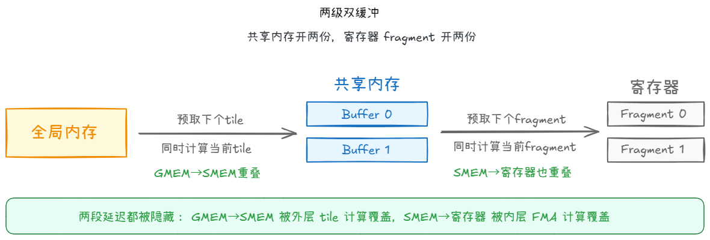

**布局说明**：

本版共享内存 Ads/Bds 采用 [BK][BM]/[BK][BN] 转置布局

原因：内层 fragment 读取时固定 bk、沿 BM/BN 方向连续读，转置后地址连续，支持 float4 向量化读取。

**关键代码实现**：

每线程开 2 份 fragment，交替使用：float a_frag[2][TM], b_frag[2][TN]; 

沿用 GEMM10 的「issue/commit」封装风格：
- issue_gmem_load：发全局内存 LDG 到中转寄存器，不等
- commit_gmem_store：中转寄存器数据落共享内存（消费 LDG）
- issue_frag_load：发共享内存 LDG 到 fragment 寄存器，不等
- commit_frag_fma：用 fragment 数据做 FMA 计算（消费 LDG）

```cpp
__global__ void GEMM11(float* C, const float* A, const float* B, int M, int N, int K) {
    constexpr int BK = 32, BM = 128, BN = 128, TM = 8, TN = 8;
    extern __shared__ char smem[];
    // 共享内存双缓冲（第一层）：转置布局，方便寄存器 fragment 沿 BM/BN 方向连续读取
    auto& Ads = *reinterpret_cast<float (*)[2][BK][BM]>(smem);
    auto& Bds = *reinterpret_cast<float (*)[2][BK][BN]>(smem + 2 * BK * BM * sizeof(float));
    int ty = threadIdx.y, tx = threadIdx.x;
    int tid = ty * blockDim.x + tx;
    int tile_m = ty * TM, tile_n = tx * TN;  // 输出 tile 里的行起点、列起点
    float val[TM][TN] = {0.0f};
    int buf = 0;

    // ------ 第一层流水：全局内存 → 共享内存 ------
    float4 ldg_a[4], ldg_b[4];  // 全局加载的中转寄存器（每线程 4+4 个 float4）
    // 动作一：发全局 LDG（数据进中转寄存器，不等！warp 立即继续）
    auto issue_gmem_load = [&](int tile) {
        #pragma unroll
        for (int i = 0; i < 4; i++) {
            int idx = tid + i * 256;
            int m = idx / (BK / 4), k = (idx % (BK / 4)) * 4;
            ldg_a[i] = *(const float4*)&A[(blockIdx.y * BM + m) * K + tile + k];
        }
        #pragma unroll
        for (int i = 0; i < 4; i++) {
            int idx = tid + i * 256;
            int k = idx / (BN / 4), n = (idx % (BN / 4)) * 4;
            ldg_b[i] = *(const float4*)&B[(tile + k) * N + blockIdx.x * BN + n];
        }
    };
    // 动作二：中转寄存器数据落共享（消费 LDG，这里才等；A 做转置写入）
    auto commit_gmem_store = [&](int b) {
        #pragma unroll
        for (int i = 0; i < 4; i++) {
            int idx = tid + i * 256;
            int m = idx / (BK / 4), k = (idx % (BK / 4)) * 4;
            // 转置写入：A 全局 [BM][BK] → 共享 [BK][BM]，逐个分量写入完成转置
            Ads[b][k + 0][m] = ldg_a[i].x;
            Ads[b][k + 1][m] = ldg_a[i].y;
            Ads[b][k + 2][m] = ldg_a[i].z;
            Ads[b][k + 3][m] = ldg_a[i].w;
        }
        #pragma unroll
        for (int i = 0; i < 4; i++) {
            int idx = tid + i * 256;
            int k = idx / (BN / 4), n = (idx % (BN / 4)) * 4;
            // B 无需转置，直接 float4 写入共享 [BK][BN]
            *(float4*)&Bds[b][k][n] = ldg_b[i];
        }
    };

    // ------ 第二层流水：共享内存 → 寄存器 Fragment ------
    float a_frag[2][TM], b_frag[2][TN];  // fragment 双缓冲（开 2 份，交替使用）
    // 动作一：发共享 LDG（数据进 fragment 寄存器，不等！）
    auto issue_frag_load = [&](int b, int bk) {
        #pragma unroll
        for (int m = 0; m < TM; m += 4)
            // 读的是 bk+1（下一排）、写进 (bk+1)%2（另一份缓冲）—— 预取下一排用的数据
            *(float4*)&a_frag[(bk + 1) % 2][m] = *(const float4*)&Ads[b][bk + 1][tile_m + m];
        #pragma unroll
        for (int n = 0; n < TN; n += 4)
            *(float4*)&b_frag[(bk + 1) % 2][n] = *(const float4*)&Bds[b][bk + 1][tile_n + n];
    };
    // 动作二：用 fragment 数据做 FMA（消费 LDG，这里才等）
    auto commit_frag_fma = [&](int bk) {
        #pragma unroll
        for (int m = 0; m < TM; m++)
            #pragma unroll
            for (int n = 0; n < TN; n++)
                // 用的是 bk%2（上一轮预取好的）
                val[m][n] += a_frag[bk % 2][m] * b_frag[bk % 2][n];
    };

    // ------ 预加载：首次填充流水线 ------
    // 从 gmem 预加载 tile 0 到 smem
    issue_gmem_load(0);
    commit_gmem_store(0);
    __syncthreads();
    // 从 smem 预加载 bk=0 的 fragment 到寄存器（这里手写而不调用 issue_frag_load 因为 issue_frag_load 读的是 bk+1(下一块)）
    #pragma unroll
    for (int m = 0; m < TM; m += 4)
        *(float4*)&a_frag[0][m] = *(const float4*)&Ads[0][0][tile_m + m];
    #pragma unroll
    for (int n = 0; n < TN; n += 4)
        *(float4*)&b_frag[0][n] = *(const float4*)&Bds[0][0][tile_n + n];

    // ------ 主循环：两层流水嵌套 ------
    for (int tile = 0; tile < K; tile += BK) {    // 外层循环（tile 级）：一次搬 32 行 k 的整块数据（tile），在 "全局→共享" 之间双缓冲交替
        int next_tile = tile + BK;
        int next_buf = 1 - buf;
        // 一层流水：提前发 next tile 的全局 LDG（不等，数据在途）
        if (next_tile < K)
            issue_gmem_load(next_tile);
        // 二层流水：内层 bk 循环，fragment 级流水
        #pragma unroll
        for (int bk = 0; bk < BK - 1; bk++) {    // 内层循环（bk 级）：一次扫 1 行 k 的 fragment，在 "共享→寄存器" 之间双缓冲交替，边预取边算
            issue_frag_load(buf, bk);  // 预取 bk+1 的 fragment（不等）
            commit_frag_fma(bk);        // 计算 bk 的 FMA
        }
        commit_frag_fma(BK - 1);  // 最后一行 bk=31，没下一行可预取，直接算
        // 一层流水：next tile 落共享内存
        if (next_tile < K) {
            commit_gmem_store(next_buf);
            __syncthreads();
            // 预取下一个 tile 的第一个 fragment，为下一轮外层循环做准备（流水线的第一块总要手动放上去）
            #pragma unroll
            for (int m = 0; m < TM; m += 4)
                *(float4*)&a_frag[0][m] = *(const float4*)&Ads[next_buf][0][tile_m + m];
            #pragma unroll
            for (int n = 0; n < TN; n += 4)
                *(float4*)&b_frag[0][n] = *(const float4*)&Bds[next_buf][0][tile_n + n];
        }
        buf = next_buf;  // 翻转共享内存 buffer
    }

    // 写回输出
    #pragma unroll
    for (int i = 0; i < TM; i++)
        #pragma unroll
        for (int j = 0; j < TN; j += 4) {
            float4 v = {val[i][j], val[i][j+1], val[i][j+2], val[i][j+3]};
            *(float4*)&C[(blockIdx.y * BM + tile_m + i) * N + blockIdx.x * BN + tile_n + j] = v;
        }
}
```

**性能（native 4096）**：

| 版本 | 耗时(ms) | TFLOPS | 占cuBLAS % |
| --- | ---: | ---: | ---: |
| GEMM10 | 17.79 | 7.73 | 78.5% |
| GEMM10B | 16.82 | 8.17 | 83.0% |
| GEMM11 | 17.80 | 7.72 | 78.4% |

**sm_80 编译下全尺寸对比（占 cuBLAS %）**：

| 尺寸 | GEMM10 | GEMM11 | 提升率 |
| --- | ---: | ---: | ---: |
| 1024 | 65.9% | 76.5% | +13.9% |
| 2048 | 77.7% | 88.5% | +12.2% |
| 3072 | 77.8% | 89.9% | +13.4% |
| 4096 | 74.7% | 80.3% | +7.0% |
| 5120 | 81.0% | 87.8% | +7.7% |
| 6144 | 80.6% | 87.9% | +8.3% |

**收益**：二级流水本身是有效的，sm_80（Ampere）环境下全尺寸提升。native（Blackwell）下却几乎无收益 —— 差异主要在编译器：native 目标下 nvcc 已把 GEMM10 的共享读取自动软件流水化，手写 fragment 双缓冲失去增量。与 GEMM9B 段结论一致。

**代价**：寄存器占用进一步攀升：fragment 双缓冲 32 + LDG 中转 32 + val 64，这三块就约 128 个/线程，加上两级流水的地址与循环变量，占用率锁死 1 block/SM。

<br>

## GEMM11B：B 侧走 cp.async

**GEMM11** 的 B 侧共享布局为 [BK][BN]，与全局 B 的 [K][N] 行主序对齐，搬运 B 不需要转置，因此可以把 B 侧的软件 LDG 替换为 cp.async 硬件 DMA 直拷。

A 侧需要转置写入 [BK][BM]，仍然只能走 软件LDG + 逐分量转置STS。

**本版与 GEMM11 的唯一区别**：
- B 侧：软件 LDG/STS → cp.async（加载指令从占用 寄存器/warp/LSU 的软件路径换成 DMA 直拷）
- A 侧：完全不变

```cpp
__global__ void GEMM11B(float* C, const float* A, const float* B, int M, int N, int K) {
    constexpr int BK = 32, BM = 128, BN = 128, TM = 8, TN = 8;
    extern __shared__ char smem[];
    auto& Ads = *reinterpret_cast<float (*)[2][BK][BM]>(smem);
    auto& Bds = *reinterpret_cast<float (*)[2][BK][BN]>(smem + 2 * BK * BM * sizeof(float));
    int ty = threadIdx.y, tx = threadIdx.x;
    int tid = ty * blockDim.x + tx;
    int tile_m = ty * TM, tile_n = tx * TN;
    float val[TM][TN] = {0.0f};
    int buf = 0;

    // A 侧：软件 LDG 中转（需要转置，不能用 cp.async）
    float4 ldg_a[4];
    auto issue_a_load = [&](int tile) {
        #pragma unroll
        for (int i = 0; i < 4; i++) {
            int idx = tid + i * 256;
            int m = idx / (BK / 4), k = (idx % (BK / 4)) * 4;
            ldg_a[i] = *(const float4*)&A[(blockIdx.y * BM + m) * K + tile + k];
        }
    };
    auto commit_a_store = [&](int b) {
        #pragma unroll
        for (int i = 0; i < 4; i++) {
            int idx = tid + i * 256;
            int m = idx / (BK / 4), k = (idx % (BK / 4)) * 4;
            Ads[b][k + 0][m] = ldg_a[i].x;
            Ads[b][k + 1][m] = ldg_a[i].y;
            Ads[b][k + 2][m] = ldg_a[i].z;
            Ads[b][k + 3][m] = ldg_a[i].w;
        }
    };

    // 第二层流水：fragment 双缓冲（两条路径共用）
    float a_frag[2][TM], b_frag[2][TN];
    auto issue_frag_load = [&](int b, int bk) {
        #pragma unroll
        for (int m = 0; m < TM; m += 4)
            *(float4*)&a_frag[(bk + 1) % 2][m] = *(const float4*)&Ads[b][bk + 1][tile_m + m];
        #pragma unroll
        for (int n = 0; n < TN; n += 4)
            *(float4*)&b_frag[(bk + 1) % 2][n] = *(const float4*)&Bds[b][bk + 1][tile_n + n];
    };
    auto commit_frag_fma = [&](int bk) {
        #pragma unroll
        for (int m = 0; m < TM; m++)
            #pragma unroll
            for (int n = 0; n < TN; n++)
                val[m][n] += a_frag[bk % 2][m] * b_frag[bk % 2][n];
    };

    // B 侧：cp.async 直拷（无转置，布局对齐）
    auto issue_b_copy = [&](int b, int tile) {
        #pragma unroll
        for (int i = 0; i < 4; i++) {
            int idx = tid + i * 256;
            int k = idx / (BN / 4), n = (idx % (BN / 4)) * 4;
            asm volatile("cp.async.ca.shared.global [%0], [%1], 16;"
                : : "l"(&Bds[b][k][n]), "l"(&B[(tile + k) * N + blockIdx.x * BN + n]) : "memory");
        }
    };
    // 预加载 tile 0：A LDG + B cp.async，提交并全部等待
    issue_a_load(0);
    issue_b_copy(0, 0);
    asm volatile("cp.async.commit_group;" ::: "memory");
    asm volatile("cp.async.wait_group 0;" ::: "memory");
    commit_a_store(0);
    __syncthreads();
    #pragma unroll
    for (int m = 0; m < TM; m += 4)
        *(float4*)&a_frag[0][m] = *(const float4*)&Ads[0][0][tile_m + m];
    #pragma unroll
    for (int n = 0; n < TN; n += 4)
        *(float4*)&b_frag[0][n] = *(const float4*)&Bds[0][0][tile_n + n];
    // 主循环
    for (int tile = 0; tile < K; tile += BK) {
        int next_tile = tile + BK;
        int next_buf = 1 - buf;
        if (next_tile < K) {
            issue_a_load(next_tile);
            issue_b_copy(next_buf, next_tile);
            asm volatile("cp.async.commit_group;" ::: "memory");
        }
        // 内层 fragment 流水
        #pragma unroll
        for (int bk = 0; bk < BK - 1; bk++) {
            issue_frag_load(buf, bk);
            commit_frag_fma(bk);
        }
        commit_frag_fma(BK - 1);
        if (next_tile < K) {
            // 计算结束，等 B next 全部到位，再落 A next，并预取 fragment
            asm volatile("cp.async.wait_group 0;" ::: "memory");
            commit_a_store(next_buf);
            __syncthreads();
            #pragma unroll
            for (int m = 0; m < TM; m += 4)
                *(float4*)&a_frag[0][m] = *(const float4*)&Ads[next_buf][0][tile_m + m];
            #pragma unroll
            for (int n = 0; n < TN; n += 4)
                *(float4*)&b_frag[0][n] = *(const float4*)&Bds[next_buf][0][tile_n + n];
        } else {
            asm volatile("cp.async.wait_group 0;" ::: "memory");
        }
        buf = next_buf;
    }

    #pragma unroll
    for (int i = 0; i < TM; i++)
        #pragma unroll
        for (int j = 0; j < TN; j += 4) {
            float4 v = {val[i][j], val[i][j+1], val[i][j+2], val[i][j+3]};
            *(float4*)&C[(blockIdx.y * BM + tile_m + i) * N + blockIdx.x * BN + tile_n + j] = v;
        }
}
```

> 为什么用 wait_group 0 而不是 1：

> 外层循环开头发 next tile 的 A LDG + B cp.async（commit_group），内层计算 current tile（DMA 与计算重叠），计算结束后立刻要预取 next tile 的 fragment，需要 B next 全部到位，因此用 wait_group 0（计算已覆盖搬运，等待不阻塞）。

| 版本 | 耗时(ms) | TFLOPS | 占cuBLAS % |
| --- | ---: | ---: | ---: |
| GEMM11 | 17.80 | 7.72 | 78.4% |
| GEMM11B | 16.39 | 8.39 | 85.2% |

GEMM11B 在 native 下也有效，因为 cp.async 是编译器无法帮忙做的，这个增量不依赖编译目标。
而且 GEMM9 时期 LSU 带宽充裕，软件加载的指令开销被流水充分隐藏；到 GEMM11 两级流水后，共享内存管线已被 fragment 读取吃满，B 侧每轮的软件写变成抢带宽的负担 —— 换 cp.async 后管线带宽让给 fragment 读取，收益更明显。

<br>

## GEMM12：自定义分块形状

在本机上选择出最优尺寸：BK：32→16，TM：8→16，TN 保持 8，线程 256→128。

**改动**：
1. **K 分块收窄**：双缓冲共享内存从 64 KB 减半到 32 KB；K 循环次数翻倍，流水线的步长更细，隐藏延迟的效果更好；
2. **计算粒度放大**：每线程负责的输出从 64 个增到 128 个（16×8），工作量翻倍，线程数减半，单线程指令级并行（ILP）更强，编译器更容易排满流水线。

```cpp
__global__ void GEMM12(float* C, const float* A, const float* B, int M, int N, int K) {
    constexpr int BK = 16, BM = 128, BN = 128, TM = 16, TN = 8;
    constexpr int BLOCK_THREADS = 128;
    constexpr int A_ROUNDS = BK * BM / BLOCK_THREADS / 4;  // BK=16 → 每线程 4 个 float4
    constexpr int B_ROUNDS = BK * BN / BLOCK_THREADS / 4;  // 同上
    extern __shared__ char smem[];
    auto& Ads = *reinterpret_cast<float (*)[2][BK][BM]>(smem);
    auto& Bds = *reinterpret_cast<float (*)[2][BK][BN]>(smem + 2 * BK * BM * sizeof(float));
    int ty = threadIdx.y, tx = threadIdx.x;
    int tid = ty * blockDim.x + tx;
    int tile_m = ty * TM, tile_n = tx * TN;
    float val[TM][TN] = {0.0f};
    int buf = 0;

    // A 侧：软件 LDG 中转（需要转置，不能用 cp.async）
    float4 ldg_a[A_ROUNDS];
    auto issue_a_load = [&](int tile) {
        #pragma unroll
        for (int i = 0; i < A_ROUNDS; i++) {
            int idx = tid + i * BLOCK_THREADS;
            int m = idx / (BK / 4), k = (idx % (BK / 4)) * 4;
            ldg_a[i] = *(const float4*)&A[(blockIdx.y * BM + m) * K + tile + k];
        }
    };
    auto commit_a_store = [&](int b) {
        #pragma unroll
        for (int i = 0; i < A_ROUNDS; i++) {
            int idx = tid + i * BLOCK_THREADS;
            int m = idx / (BK / 4), k = (idx % (BK / 4)) * 4;
            Ads[b][k + 0][m] = ldg_a[i].x;
            Ads[b][k + 1][m] = ldg_a[i].y;
            Ads[b][k + 2][m] = ldg_a[i].z;
            Ads[b][k + 3][m] = ldg_a[i].w;
        }
    };

    // 第二层流水：fragment 双缓冲（AB两路共用）
    float a_frag[2][TM], b_frag[2][TN];
    auto issue_frag_load = [&](int b, int bk) {
        #pragma unroll
        for (int m = 0; m < TM; m += 4)
            *(float4*)&a_frag[(bk + 1) % 2][m] = *(const float4*)&Ads[b][bk + 1][tile_m + m];
        #pragma unroll
        for (int n = 0; n < TN; n += 4)
            *(float4*)&b_frag[(bk + 1) % 2][n] = *(const float4*)&Bds[b][bk + 1][tile_n + n];
    };
    auto commit_frag_fma = [&](int bk) {
        #pragma unroll
        for (int m = 0; m < TM; m++)
            #pragma unroll
            for (int n = 0; n < TN; n++)
                val[m][n] += a_frag[bk % 2][m] * b_frag[bk % 2][n];
    };

    // B 侧：cp.async 直拷（无转置，布局对齐）
    auto issue_b_copy = [&](int b, int tile) {
        #pragma unroll
        for (int i = 0; i < B_ROUNDS; i++) {
            int idx = tid + i * BLOCK_THREADS;
            int k = idx / (BN / 4), n = (idx % (BN / 4)) * 4;
            asm volatile("cp.async.ca.shared.global [%0], [%1], 16;"
                : : "l"(&Bds[b][k][n]), "l"(&B[(tile + k) * N + blockIdx.x * BN + n]) : "memory");
        }
    };
    // 预加载 tile 0：A LDG + B cp.async，提交并全部等待
    issue_a_load(0);
    issue_b_copy(0, 0);
    asm volatile("cp.async.commit_group;" ::: "memory");
    asm volatile("cp.async.wait_group 0;" ::: "memory");
    commit_a_store(0);
    __syncthreads();
    #pragma unroll
    for (int m = 0; m < TM; m += 4)
        *(float4*)&a_frag[0][m] = *(const float4*)&Ads[0][0][tile_m + m];
    #pragma unroll
    for (int n = 0; n < TN; n += 4)
        *(float4*)&b_frag[0][n] = *(const float4*)&Bds[0][0][tile_n + n];

    // 主循环
    for (int tile = 0; tile < K; tile += BK) {
        int next_tile = tile + BK;
        int next_buf = 1 - buf;
        if (next_tile < K) {
            issue_a_load(next_tile);
            issue_b_copy(next_buf, next_tile);
            asm volatile("cp.async.commit_group;" ::: "memory");
        }
        // 内层 fragment 流水
        #pragma unroll
        for (int bk = 0; bk < BK - 1; bk++) {
            issue_frag_load(buf, bk);
            commit_frag_fma(bk);
        }
        commit_frag_fma(BK - 1);
        if (next_tile < K) {
            // 计算结束，等 B next 全部到位，再落 A next，并预取 fragment
            asm volatile("cp.async.wait_group 0;" ::: "memory");
            commit_a_store(next_buf);
            __syncthreads();
            #pragma unroll
            for (int m = 0; m < TM; m += 4)
                *(float4*)&a_frag[0][m] = *(const float4*)&Ads[next_buf][0][tile_m + m];
            #pragma unroll
            for (int n = 0; n < TN; n += 4)
                *(float4*)&b_frag[0][n] = *(const float4*)&Bds[next_buf][0][tile_n + n];
        } else {
            asm volatile("cp.async.wait_group 0;" ::: "memory");
        }
        buf = next_buf;
    }

    #pragma unroll
    for (int i = 0; i < TM; i++)
        #pragma unroll
        for (int j = 0; j < TN; j += 4) {
            float4 v = {val[i][j], val[i][j+1], val[i][j+2], val[i][j+3]};
            *(float4*)&C[(blockIdx.y * BM + tile_m + i) * N + blockIdx.x * BN + tile_n + j] = v;
        }
}
```

| 版本 | 耗时(ms) | TFLOPS | 占cuBLAS % |
| --- | ---: | ---: | ---: |
| GEMM11B | 16.39 | 8.39 | 85.2% |
| GEMM12 | 12.67 | 10.85 | 110.2% |

> TM 翻倍后，每线程需要的累加器数量翻倍，寄存器占用暴增到 247（硬件上限 255），但本机已经固定一个 SM 处理一个 block，即使拉满寄存器也不会再影响占用率。

BK 收窄让流水步长更细，TM 放大让单线程 ILP 更强。两个方向的调整收益叠加，在本机上首次超过 cuBLAS。

<br>

## 工业基准：cuBLAS / cuBLASLt（FP32）

官方库：作为以上 GEMM1-GEMM12 所有手写 kernel 的性能分母。

```cpp
cublasSgemm(handle, CUBLAS_OP_N, CUBLAS_OP_N,
    N, M, K, &alpha, B, N, A, K, &beta, C, N);
```

cuBLAS 默认列主序。行主序的 `C(M,N) = A(M,K) · B(K,N)` 在列主序视角下等价于 `C(N,M) = B(N,K) · A(K,M)`，调用时指针和 M、N 都要对调：

cuBLASLt 是可配置层，通过 matmul desc、layout、heuristic 三个描述符让库自行选择 kernel，并可使用 workspace。

---

<br>

---

<div align="center">
  <h1> GEMM_wmma 优化</h1>

  
  
  
  
  
  
</div>

# Tensor Core 主线

Tensor Core（wmma，FP16）。6 个版本从 wmma 指令入门到追平 cuBLAS（Tensor）的完整优化过程。

### 主线说明

FP32 主线证明了手写 SIMT kernel 可以追平并反超 cuBLAS FP32。现代大模型推理的主力运算是 FP16/BF16 低精度矩阵乘：同样硬件下 FP16 算力通常是 FP32 的两倍，显存占用减半。Tensor Core 是这类算力的硬件载体，wmma 是其高层编程接口。

这条主线讲 Tensor Core 下使用 wmma 指令编程 GEMM 的完整路径，顺带尝试一些负优化。

本段所有"占 cuBLAS %"的分母是 cuBLAS FP16，Tensor Op（GEMM21），与 FP32 主线以 cuBLAS FP32（GEMM13）为分母不同。两条主线的百分比各自与同精度库对照，不能混淆对比。

> wmma 需要 sm_70+，T4 及以上均支持。

> GEMM17-GEMM20、GEMM22 的 cp.async 需要 sm_80+，低架构会自动回退软件加载。

> 全部版本使用 FP16 输入（g_A_half / g_B_half）、FP32 输出。

### 版本清单

| 版本 | 增量 |
| --- | --- |
| GEMM15 | wmma 朴素版：Tensor Core 指令入门|
| GEMM16 | 共享内存分块（BM=BN=128，BK=32，每 warp 32×64） |
| GEMM17 | cp.async 双缓冲 + 更大 Warp Tile（BN=256，每 warp 64×64） |
| GEMM18 | 共享内存 Padding 消 Bank 冲突（行宽 +8 half） |
| GEMM19 | 主循环 unroll 32 + 地址外提 |
| GEMM20 | NSPLIT：L2 缓存优化（大尺寸更优） |
| GEMM21 | cuBLAS FP16（Tensor Op）官方标准 |
| GEMM22 | 手写 Fragment 流水（负优化演示） |

### 性能总览

原始输出见 [test/benchmark_wmma_native.txt](test/benchmark_wmma_native.txt) 与 [test/benchmark_wmma_sm80.txt](test/benchmark_wmma_sm80.txt)。

**占 cuBLAS %（分母 = GEMM21 cuBLAS Tensor）**

**-arch=native：**

| 版本 | 1024 | 2048 | 3072 | 4096 | 5120 | 6144 |
| --- | ---: | ---: | ---: | ---: | ---: | ---: |
| GEMM15 | 26.3% | 27.2% | 25.6% | 25.5% | 21.9% | 20.8% |
| GEMM16 | 36.6% | 56.4% | 54.5% | 51.3% | 49.2% | 47.3% |
| GEMM17 | 50.2% | 78.3% | 73.4% | 79.3% | 76.8% | 74.5% |
| GEMM18 | 56.9% | 91.2% | 83.2% | 89.2% | 85.1% | 81.3% |
| GEMM19 | 61.5% | 102.0% | 94.6% | 102.0% | 94.5% | 91.0% |
| GEMM20 | 61.5% | 94.8% | 92.4% | 104.6% | 98.5% | 99.5% |

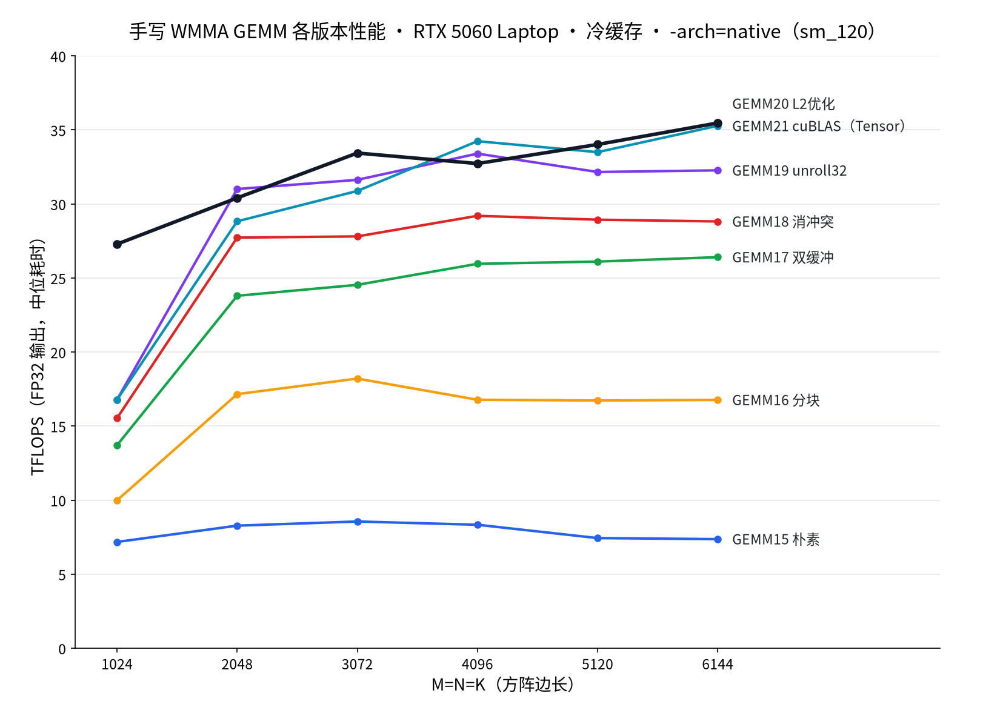

**-arch=sm_80：**

| 版本 | 1024 | 2048 | 3072 | 4096 | 5120 | 6144 |
| --- | ---: | ---: | ---: | ---: | ---: | ---: |
| GEMM15 | 26.3% | 26.8% | 24.8% | 24.3% | 22.0% | 20.7% |
| GEMM16 | 47.9% | 66.7% | 66.0% | 62.0% | 58.1% | 54.5% |
| GEMM17 | 46.6% | 71.9% | 72.7% | 71.8% | 71.7% | 68.7% |
| GEMM18 | 55.4% | 85.0% | 87.7% | 84.5% | 83.4% | 78.8% |
| GEMM19 | 61.6% | 97.9% | 101.0% | 99.8% | 95.7% | 91.9% |
| GEMM20 | 61.6% | 95.4% | 96.2% | 101.5% | 100.9% | 98.0% |

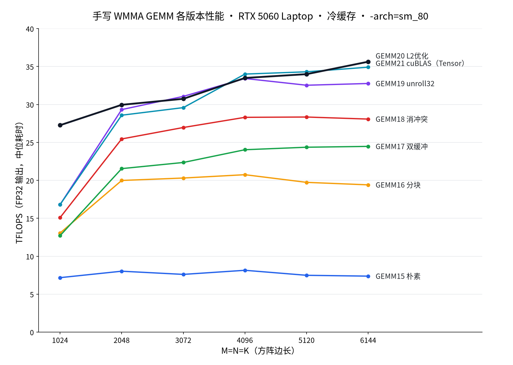

> GEMM22（负优化）不入主表，双口径均低于 GEMM20

**结论**：

- 手写 WMMA kernel 可以追平并小幅反超 cuBLAS Tensor：native 下 GEMM19/GEMM20 在 4096 达 102.0% / 104.6%，sm_80 下 GEMM20 达 101.5%。
- NSPLIT（GEMM20）的收益随尺寸增长：≤3072 与 GEMM19 相当或略低，≥4096 反超。

---

### 前置知识：wmma 三件套

Tensor Core 要求把 16x16 的矩阵切片放入寄存器，  
再用一条指令完成整个 16x16x16 的乘加（等效 8192 次 FMA）。  
这个 "寄存器里的矩阵切片" 就是 fragment，由整个 warp 共享，wmma 指令是 warp 级同步操作。

- `fragment`：内部 16x16 的排布由硬件决定，不是 "线程 i 管第 i 行"，编译器负责翻译成对应寄存器分配。  
    （这是 wmma 与手写 PTX mma.sync 的区别：wmma 是高层 API，布局细节被封装）
- `load_matrix_sync`：全局/共享内存 → fragment（加载）；
- `mma_sync`：`c_frag += a_frag * b_frag`（计算）；
- `store_matrix_sync`：fragment → 全局内存（写回）。

<br>

---

## 详细优化代码与完整讲解注释见文件 [GEMM_wmma.cu](GEMM_wmma.cu)

<br>

## 文件结构

```
GEMM/
├── GEMM.cu                      # FP32 主线：19 个版本（17 个手写 kernel + cuBLAS/cuBLASLt）
├── GEMM_wmma.cu                 # Tensor Core 主线：8 个版本（7 个手写 kernel + cuBLAS FP16）
├── images/                      # 性能与原理图 + excalidraw 原始文件
├── test/
│   ├── benchmark_native.txt     # FP32 主线 -arch=native 完整原始输出（19 版本 × 6 尺寸）
│   ├── benchmark_sm80.txt       # FP32 主线 -arch=sm_80 完整原始输出（19 版本 × 6 尺寸）
│   ├── benchmark_wmma_native.txt  # Tensor 主线 -arch=native 完整原始输出（8 版本 × 6 尺寸）
│   └── benchmark_wmma_sm80.txt    # Tensor 主线 -arch=sm_80 完整原始输出（8 版本 × 6 尺寸）
├── LICENSE
└── README.md
```

## 编译与运行

依赖：CUDA Toolkit 11.0+（`cp.async` 与 sm_120 需要 CUDA 12.x）、cuBLAS、cuBLASLt。

所有编译与运行命令分别在 `GEMM.cu`（FP32 主线）与 `GEMM_wmma.cu`（Tensor Core 主线）开头的注释里有写

## 基准测试方法

- **计时方式**：CUDA Event 记录 kernel 时长，只统计 GPU 执行时间，不含数据准备。
- **交替采样**：5 轮测量，每轮把全部 kernel 依次跑一遍；偶数轮正序、奇数轮倒序（FP32 主线 19 个 kernel 正序 1→19 / 倒序 19→1，Tensor Core 主线 8 个 kernel 正序 1→8 / 倒序 8→1），把 GPU 时钟与温度漂移平均分摊给所有 kernel。
- **样本数量**：过慢的朴素 kernel 每轮 4 次共 20 个样本（GEMM1、GEMM2、GEMM15），其余每轮 20 次共 100 个样本；同时输出平均值与中位数，图表统一用中位数。
- **冷缓存**：`./GEMM cold` 与 `./GEMM_wmma cold` 在每个样本前启动一个 kernel，向 100 MB 缓冲区写数据冲刷 L2，迫使 A、B 从显存重新加载。
- **正确性**：每个 kernel 与 CPU 参考实现逐元素比对；FP32 主线最大误差超过 1e-2 即退出，Tensor Core 主线为 FP16 输入、容差放宽至 1.0。
- **TFLOPS 公式**：`2·M·N·K / 中位耗时(ms) / 1e9`（FMA 计为 2 次浮点运算）。
- **尺寸序列**：1024、2048、3072、4096、5120、6144（方阵）。
- **占 cuBLAS 口径**：FP32 主线分母为 cuBLAS/cuBLASLt（FP32），Tensor Core 主线分母为 cuBLAS（FP16 Tensor，GEMM21），两条主线的百分比不可混淆对比。

## 参考资料

- [CUDA C++ Programming Guide — Shared Memory / Asynchronous Copies](https://docs.nvidia.com/cuda/cuda-c-programming-guide/)
- [How to Optimize a CUDA Matmul Kernel for cuBLAS-like Performance（siboehm）](https://siboehm.com/articles/22/CUDA-MMM)：本项目原理示意图的排版参考
- [cuBLAS 库文档](https://docs.nvidia.com/cuda/cublas/)
- [Nsight Compute 文档](https://docs.nvidia.com/nsight-compute/)

## License

MIT


